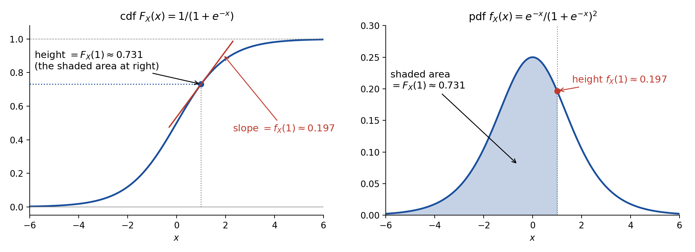

# Week 3: Independence, Random Variables, and Distributions

**Reading:** Casella & Berger (C&B) §1.3 (independence, pp. 24–27) and §§1.4–1.6

| Lecture | Date | Topics | C&B |
|---|---|---|---|
| **3.1** | Tue. Oct. 13 | Independence of two and of several events; random variables; induced probability functions | §1.3 (end), §1.4 |
| **3.2** | Thu. Oct. 15 | Cumulative distribution functions; continuous and discrete random variables; identically distributed random variables; probability mass and density functions | §§1.5–1.6 |

**Notation.** Random variables are uppercase ($X$, $Y$); their realized values are lowercase ($x$, $y$). $\mathcal{X}$ is the range of $X$. $F_X$ is the cdf of $X$ and $f_X$ its pmf or pdf. $\mathcal{B}^1$ is the Borel sigma algebra on the real line: the smallest sigma algebra containing all intervals. $X \sim F_X(x)$ reads "$X$ is distributed as $F_X(x)$."

---

# Independence

> **Way of thinking.** Translate intuition into equations.

## 1. Independence of two events

Sometimes learning $B$ tells us nothing about $A$: $P(A \mid B) = P(A)$. By Bayes' rule (1.3.5) this implies $P(B \mid A) = P(B)$, and by the multiplication rule $P(A \cap B) = P(A) P(B)$. We take the symmetric version as the definition.

**Definition 1.3.7.** Two events, $A$ and $B$, are **statistically independent** if

$$
P(A \cap B) = P(A)\, P(B). \tag{1.3.8}
$$

This definition is symmetric in $A$ and $B$, does not require $P(B) > 0$, and extends to more than two events.

**Example 1.3.8 (Chevalier de Méré).** Is it a good bet that at least one six appears in 4 rolls of a die? By independence of the rolls,

$$
P(\text{at least one 6 in 4 rolls}) = 1 - P(\text{no 6 in 4 rolls}) = 1 - \left( \frac{5}{6} \right)^4 \approx 0.518.
$$

De Méré also bet on at least one double six in 24 rolls of two dice, reasoning that it should be equally likely. In fact $1 - (35/36)^{24} \approx 0.491$, a losing bet. His losses prompted the Pascal–Fermat correspondence of 1654, often taken as the birth of probability theory.

**Theorem 1.3.9.** If $A$ and $B$ are independent events, then the following pairs are also independent:

- **(a)** $A$ and $B^c$,
- **(b)** $A^c$ and $B$,
- **(c)** $A^c$ and $B^c$.

**Proof of (a).** By Theorem 1.2.9(a) and independence,

$$
P(A \cap B^c) = P(A) - P(A \cap B) = P(A) - P(A) P(B) = P(A) \big( 1 - P(B) \big) = P(A) P(B^c). \qquad \square
$$

Parts (b) and (c) are Exercise 1.40.

**Independent vs. disjoint.** These are very different. If $P(A) > 0$ and $P(B) > 0$ and $A, B$ are disjoint, then $P(A \cap B) = 0 \ne P(A) P(B)$, so they are **dependent**: learning that $A$ occurred tells you $B$ did not (Exercise 1.39).

## 2. Independence of several events

What should it mean for $A$, $B$, and $C$ to be independent? Two natural guesses both fail.

**Guess 1: $P(A \cap B \cap C) = P(A) P(B) P(C)$ is enough. False.**

**Example 1.3.10 (Tossing two dice).** Roll two dice, with $S$ the 36 equally likely ordered pairs. Let $A$ = "doubles," $B$ = "the sum is between 7 and 10," and $C$ = "the sum is 2, 7, or 8." Then $P(A) = 1/6$, $P(B) = 1/2$, $P(C) = 1/3$, and

$$
P(A \cap B \cap C) = P(\lbrace (4,4) \rbrace) = \frac{1}{36} = \frac{1}{6} \cdot \frac{1}{2} \cdot \frac{1}{3}.
$$

But $P(B \cap C) = P(\text{sum equals 7 or 8}) = 11/36 \ne P(B) P(C) = 1/6$. Similarly, $P(A \cap B) \ne P(A) P(B)$, so the triple product condition does not even guarantee pairwise independence.

**Guess 2: pairwise independence is enough. False.**

**Example 1.3.11 (Letters).** Let $S$ consist of the $3!$ permutations of the letters a, b, and c along with the three triples of each letter, each with probability $1/9$:

$$
S = \lbrace aaa, \; bbb, \; ccc, \; abc, \; bca, \; cba, \; acb, \; bac, \; cab \rbrace.
$$

Let $A_i$ = "the $i$th place in the triple is occupied by a." Then $P(A_i) = 1/3$ and $P(A_i \cap A_j) = 1/9$ for all $i \ne j$, so the $A_i$ are pairwise independent. But $P(A_1 \cap A_2 \cap A_3) = P(\lbrace aaa \rbrace) = 1/9 \ne 1/27$.

**Definition 1.3.12.** A collection of events $A_1, \dots, A_n$ are **mutually independent** if for any subcollection $A_{i_1}, \dots, A_{i_k}$, we have

$$
P\left( \bigcap_{j=1}^{k} A_{i_j} \right) = \prod_{j=1}^{k} P(A_{i_j}).
$$

For three events that is four equations: three pairwise conditions plus the triple one. For $n$ events it is $2^n - n - 1$ equations.

**Example 1.3.13 (Three coin tosses–I).** Toss a coin three times, with sample space

$$
S = \lbrace HHH, HHT, HTH, THH, TTH, THT, HTT, TTT \rbrace,
$$

and assign probability $1/8$ to each point. Let $H_i$ = "toss $i$ is a head," for example $H_1 = \lbrace HHH, HHT, HTH, HTT \rbrace$. Then $P(H_i) = 1/2$,

$$
P(H_1 \cap H_2 \cap H_3) = P(\lbrace HHH \rbrace) = \frac{1}{8} = \frac{1}{2} \cdot \frac{1}{2} \cdot \frac{1}{2},
$$
$$
P(H_1 \cap H_2) = P(\lbrace HHH, HHT \rbrace) = \frac{2}{8} = \frac{1}{2} \cdot \frac{1}{2},
$$

and similarly for the other pairs. So $H_1, H_2, H_3$ are mutually independent: a head on any toss has no effect on any other toss. Conversely, assigning $1/8$ to each point is the *only* probability model with $P(H_i) = 1/2$ and $H_1, H_2, H_3$ mutually independent. This is what "three independent tosses of a fair coin" means.

**Check your understanding.**

1. If $P(A) = 0.4$, $P(B) = 0.5$, and $A$, $B$ are independent, find $P(A \cup B)$.

   

   
Show answer

   $P(A \cup B) = P(A) + P(B) - P(A) P(B) = 0.4 + 0.5 - 0.2 = 0.7$. Alternatively, by Theorem 1.3.9(c), $P(A \cup B) = 1 - P(A^c) P(B^c) = 1 - 0.6 \times 0.5 = 0.7$.

   

2. Show that if $P(B) = 1$, then $B$ is independent of every event $A$.

   

   
Show answer

   $P(A \cap B^c) \le P(B^c) = 0$, so $P(A \cap B) = P(A) - P(A \cap B^c) = P(A) = P(A) P(B)$.

   

3. A system has three components that work independently, each with probability $0.9$. It works if at least one component works. What is the probability the system works?

   

   
Show answer

   By Theorem 1.3.9 the complements are also mutually independent, so $P(\text{all fail}) = 0.1^3 = 0.001$ and $P(\text{system works}) = 0.999$.

   

---

# Random Variables

> **Way of thinking.** A random variable is neither random nor a variable: it is a *function* on the sample space. 

## 3. Definition and examples

In many experiments it is easier to work with a summary than with the original sample space. Ask 50 people whether they agree (1) or disagree (0) with a statement. The sample space has $2^{50}$ elements, ordered strings of 0s and 1s. If all we care about is $X$ = the number of people who agree, the new sample space is just $\lbrace 0, 1, \dots, 50 \rbrace$.

**Definition 1.4.1.** A **random variable** is a function from a sample space $S$ into the real numbers.

**Example 1.4.2 (Random variables).** In some experiments random variables are implicitly used:

| Experiment | Random variable |
|---|---|
| Toss two dice | $X$ = sum of the numbers |
| Toss a coin 25 times | $X$ = number of heads in 25 tosses |
| Apply different amounts of fertilizer to corn plants | $X$ = yield/acre |

## 4. The induced probability function

Defining a random variable also defines a new sample space, its range $\mathcal{X}$. We must check that the probability function $P$ on $S$ can be used for $X$.

Suppose $S = \lbrace s_1, \dots, s_n \rbrace$ with probability function $P$, and $X$ has range $\mathcal{X} = \lbrace x_1, \dots, x_m \rbrace$. We observe $X = x_i$ if and only if the outcome is an $s_j \in S$ with $X(s_j) = x_i$. So we define

$$
P_X(X = x_i) = P\big( \lbrace s_j \in S : X(s_j) = x_i \rbrace \big). \tag{1.4.1}
$$

$P_X$ is an **induced** probability function on $\mathcal{X}$, defined in terms of $P$. It satisfies the Kolmogorov Axioms (Exercise 1.45). Because of (1.4.1) we simply write $P(X = x_i)$ rather than $P_X(X = x_i)$.

**A note on notation.** Random variables are always denoted with uppercase letters and their realized values (or range) with the corresponding lowercase letters. The random variable $X$ can take the value $x$.

**Example 1.4.3 (Three coin tosses–II).** Toss a fair coin three times (Example 1.3.13) and let $X$ = number of heads.

| $s$ | HHH | HHT | HTH | THH | TTH | THT | HTT | TTT |
|---|---|---|---|---|---|---|---|---|
| $X(s)$ | 3 | 2 | 2 | 2 | 1 | 1 | 1 | 0 |

The range is $\mathcal{X} = \lbrace 0, 1, 2, 3 \rbrace$. With probability $1/8$ on each point, counting gives

| $x$ | 0 | 1 | 2 | 3 |
|---|---|---|---|---|
| $P_X(X = x)$ | $1/8$ | $3/8$ | $3/8$ | $1/8$ |

For example, $P_X(X = 1) = P(\lbrace HTT, THT, TTH \rbrace) = 3/8$.

**Example 1.4.4 (Distribution of a random variable).** We can find $P_X$ even without a complete listing. Let $S$ be the $2^{50}$ equally likely strings of 50 0s and 1s, $X$ = number of 1s, and $\mathcal{X} = \lbrace 0, 1, \dots, 50 \rbrace$. Then

$$
P_X(X = 27) = \frac{\text{number of strings with 27 1s}}{\text{number of strings}} = \frac{\binom{50}{27}}{2^{50}},
$$
and in general,
$$
P_X(X = i) = \frac{\binom{50}{i}}{2^{50}}, \quad i \in \mathcal{X}.
$$

This is Week 2's counting at work.

**Uncountable range.** If $\mathcal{X}$ is uncountable, we define $P_X$ in the same way as (1.4.1): for any set $A \subset \mathcal{X}$,

$$
P_X(X \in A) = P\big( \lbrace s \in S : X(s) \in A \rbrace \big). \tag{1.4.2}
$$

This is a legitimate probability function. (To be precise, (1.4.2) defines probabilities only for a certain sigma algebra of subsets of $\mathcal{X}$, the Borel sets. C&B do not dwell on this, and neither will we.)

**The key picture.** $\lbrace X \in A \rbrace$ is shorthand for the *event* $\lbrace s \in S : X(s) \in A \rbrace$, the inverse image of $A$ under $X$. Every probability statement about $X$ is a statement about an event in $S$.

**Check your understanding.**

1. Roll two fair dice and let $X$ = the sum. Write the event $\lbrace X = 4 \rbrace$ as a subset of $S$ and find $P(X = 4)$.

   

   
Show answer

   $\lbrace X = 4 \rbrace = \lbrace (1,3), (2,2), (3,1) \rbrace$, so $P(X = 4) = 3/36 = 1/12$.

   

2. In Example 1.4.3, let $Y = X^2$. Is $Y$ a random variable? Find the range of $Y$ and $P(Y = 4)$.

   

   
Show answer

   Yes: $Y(s) = X(s)^2$ is again a function from $S$ into the real numbers. Its range is $\lbrace 0, 1, 4, 9 \rbrace$ and $P(Y = 4) = P(X = 2) = 3/8$. Functions of random variables are the topic of Chapter 2.

   

---

# Distribution Functions, Mass Functions, and Density Functions

> **Way of thinking.** cdf vs. pdf

{: style="max-width:100%; height:auto;"}

**Figure.** The cdf (left) and pdf (right) of the logistic distribution (Examples 1.5.5 and 1.6.4). The **height** of the cdf at $x$ equals the **area** under the pdf to the left of $x$: $F_X(x) = \int_{-\infty}^{x} f_X(t)\, dt$. Going back, the **slope** of the cdf at $x$ equals the **height** of the pdf: $f_X(x) = \frac{d}{dx} F_X(x)$. At $x = 1$: $F_X(1) \approx 0.731$ and $f_X(1) \approx 0.197$.

## 5. The cumulative distribution function

**Definition 1.5.1.** The **cumulative distribution function** or **cdf** of a random variable $X$, denoted by $F_X(x)$, is defined by

$$
F_X(x) = P_X(X \le x), \quad \text{for all } x.
$$

**Example 1.5.2 (Tossing three coins).** Toss three fair coins and let $X$ = number of heads. The cdf of $X$ is

$$
F_X(x) =
\begin{cases}
0 & \text{if } -\infty < x < 0 \\
\frac{1}{8} & \text{if } 0 \le x < 1 \\
\frac{1}{2} & \text{if } 1 \le x < 2 \\
\frac{7}{8} & \text{if } 2 \le x < 3 \\
1 & \text{if } 3 \le x < \infty.
\end{cases}
\tag{1.5.1}
$$

- $F_X$ is defined for **all** real $x$, not just $x \in \mathcal{X} = \lbrace 0, 1, 2, 3 \rbrace$. For example, $F_X(2.5) = P(X \le 2.5) = P(X = 0, 1, \text{ or } 2) = 7/8$.
- $F_X$ is a step function. It jumps at each $x_i \in \mathcal{X}$, and the size of the jump at $x_i$ is $P(X = x_i)$.
- $F_X(x) = 0$ for $x < 0$ since $X$ cannot be negative, and $F_X(x) = 1$ for $x \ge 3$.

**Right-continuity.** At a jump point, $F_X$ takes the value at the *top* of the jump (note the inequalities $\le$ and $<$ in (1.5.1)). So $F_X$ is continuous when a point is approached from the right. This follows from the "$\le$" in the definition. Had we defined $F_X(x) = P_X(X < x)$, $F_X$ would be left-continuous. In general, the size of the jump at any point $x$ is

$$
P(X = x) = F_X(x) - \lim_{t \uparrow x} F_X(t).
$$

**Theorem 1.5.3.** The function $F(x)$ is a cdf if and only if the following three conditions hold:

- **a.** $\lim_{x \to -\infty} F(x) = 0$ and $\lim_{x \to \infty} F(x) = 1$.
- **b.** $F(x)$ is a nondecreasing function of $x$.
- **c.** $F(x)$ is right-continuous; that is, for every number $x_0$, $\lim_{x \downarrow x_0} F(x) = F(x_0)$.

**Outline of proof.** *Necessity* (every cdf has these properties) follows by writing $F$ in terms of the probability function (Exercise 1.48). For example, (b) holds because $x_1 < x_2$ implies $\lbrace X \le x_1 \rbrace \subset \lbrace X \le x_2 \rbrace$, so $F(x_1) \le F(x_2)$ by Theorem 1.2.9(c). Parts (a) and (c) need the continuity of probability along monotone sequences of events. *Sufficiency* (any $F$ with these properties is the cdf of some random variable) is much harder: we must construct a sample space $S$, a probability function $P$ on $S$, and a random variable $X$ on $S$ whose cdf is $F$. $\square$

**Why this theorem matters.** To specify a distribution, we do not need to build $S$ and $P$ explicitly. Any function with properties (a)–(c) will do.

**Example 1.5.4 (Tossing for a head).** Toss a coin until a head appears, where $p$ = probability of a head on any given toss, and let $X$ = number of tosses required to get a head. For $x = 1, 2, \dots$,

$$
P(X = x) = (1 - p)^{x-1} p, \tag{1.5.2}
$$

since we need $x - 1$ tails followed by a head, and the tosses are independent. For any positive integer $x$,

$$
P(X \le x) = \sum_{i=1}^{x} P(X = i) = \sum_{i=1}^{x} (1 - p)^{i-1} p. \tag{1.5.3}
$$

Using the partial sum of the geometric series (Exercise 1.50),

$$
\sum_{k=1}^{n} t^{k-1} = \frac{1 - t^n}{1 - t}, \quad t \ne 1, \tag{1.5.4}
$$

we get

$$
F_X(x) = P(X \le x) = \frac{1 - (1-p)^x}{1 - (1-p)}\, p = 1 - (1 - p)^x, \quad x = 1, 2, \dots.
$$

Between the integers $F_X$ is flat, so for all real $x \ge 1$, $F_X(x) = 1 - (1 - p)^{\lfloor x \rfloor}$, and $F_X(x) = 0$ for $x < 1$.

If $0 < p < 1$, $F_X$ satisfies Theorem 1.5.3:

- **(a)** $F_X(x) = 0$ for all $x < 0$, and $\lim_{x \to \infty} 1 - (1-p)^x = 1$.
- **(b)** The sum in (1.5.3) contains more positive terms as $x$ increases.
- **(c)** For any $x$, $F_X(x + \epsilon) = F_X(x)$ if $\epsilon > 0$ is small enough, so $\lim_{\epsilon \downarrow 0} F_X(x + \epsilon) = F_X(x)$.

This is the cdf of the **geometric distribution** (named after the series).

**Example 1.5.5 (Continuous cdf).** The function

$$
F_X(x) = \frac{1}{1 + e^{-x}} \tag{1.5.5}
$$

satisfies Theorem 1.5.3: $\lim_{x \to -\infty} F_X(x) = 0$ since $\lim_{x \to -\infty} e^{-x} = \infty$; $\lim_{x \to \infty} F_X(x) = 1$ since $\lim_{x \to \infty} e^{-x} = 0$; and

$$
\frac{d}{dx} F_X(x) = \frac{e^{-x}}{(1 + e^{-x})^2} > 0,
$$

so $F_X$ is increasing. It is not only right-continuous but continuous. This is a special case of the **logistic distribution**, the same function as the logistic (sigmoid) link in logistic regression.

**Example 1.5.6 (Cdf with jumps).** A cdf can mix continuous pieces and jumps. For some $\epsilon$ with $1 > \epsilon > 0$, let

$$
F_Y(y) =
\begin{cases}
\dfrac{1 - \epsilon}{1 + e^{-y}} & \text{if } y < 0 \\[2ex]
\epsilon + \dfrac{1 - \epsilon}{1 + e^{-y}} & \text{if } y \ge 0.
\end{cases}
\tag{1.5.6}
$$

$F_Y$ has a jump of height $\epsilon$ at $y = 0$ and is otherwise continuous (Exercise 1.47). Think of a gauge whose reading could be any real number but that sometimes sticks at 0, with $\epsilon$ the probability that it sticks.

## 6. Continuous and discrete random variables

**Definition 1.5.7.** A random variable $X$ is **continuous** if $F_X(x)$ is a continuous function of $x$. A random variable $X$ is **discrete** if $F_X(x)$ is a step function of $x$.

So Examples 1.5.2 and 1.5.4 are discrete, Example 1.5.5 is continuous, and Example 1.5.6 is neither.

**Definition 1.5.8.** The random variables $X$ and $Y$ are **identically distributed** if, for every set $A \in \mathcal{B}^1$, $P(X \in A) = P(Y \in A)$.

Identically distributed does **not** mean equal: Definition 1.5.8 does not say $X = Y$.

**Example 1.5.9 (Identically distributed random variables).** Toss a fair coin three times, and let $X$ = number of heads and $Y$ = number of tails. For each $k = 0, 1, 2, 3$, $P(X = k) = P(Y = k)$, so $X$ and $Y$ are identically distributed. However, $X(s) \ne Y(s)$ for every sample point $s$, since $X(s) + Y(s) = 3$ is odd.

**Theorem 1.5.10.** The following two statements are equivalent:

- **a.** The random variables $X$ and $Y$ are identically distributed.
- **b.** $F_X(x) = F_Y(x)$ for every $x$.

**Proof.** (a) $\Rightarrow$ (b): For every $x$, the set $(-\infty, x]$ is in $\mathcal{B}^1$, so

$$
F_X(x) = P\big( X \in (-\infty, x] \big) = P\big( Y \in (-\infty, x] \big) = F_Y(x).
$$

(b) $\Rightarrow$ (a) is much harder: agreement on all intervals $(-\infty, x]$ must be extended to agreement on all sets in $\mathcal{B}^1$. This needs heavy use of sigma algebras, and we omit it (Chung 1974, Section 2.2). $\square$

**The takeaway:** the cdf completely determines the distribution of a random variable.

## 7. Probability mass functions

**Definition 1.6.1.** The **probability mass function** (**pmf**) of a discrete random variable $X$ is given by

$$
f_X(x) = P(X = x) \quad \text{for all } x.
$$

**Example 1.6.2 (Geometric probabilities).** For the geometric distribution of Example 1.5.4,

$$
f_X(x) = P(X = x) =
\begin{cases}
(1 - p)^{x-1} p & \text{for } x = 1, 2, \dots \\
0 & \text{otherwise.}
\end{cases}
$$

$f_X(x)$ is the size of the jump in the cdf at $x$. To find the probability of an event, sum the pmf over its points: for positive integers $a \le b$,

$$
P(a \le X \le b) = \sum_{k=a}^{b} f_X(k) = \sum_{k=a}^{b} (1 - p)^{k-1} p,
$$

and as a special case,

$$
P(X \le b) = \sum_{k=1}^{b} f_X(k) = F_X(b). \tag{1.6.1}
$$

**Convention.** Uppercase letter for the cdf, the corresponding lowercase letter for the pmf or pdf: $F_X$ and $f_X$.

## 8. Probability density functions

**Point probabilities vanish for continuous random variables.** Since $\lbrace X = x \rbrace \subset \lbrace x - \epsilon < X \le x \rbrace$ for any $\epsilon > 0$, Theorem 1.2.9(c) gives

$$
P(X = x) \le P(x - \epsilon < X \le x) = F_X(x) - F_X(x - \epsilon)
$$

for any $\epsilon > 0$. Therefore, by the continuity of $F_X$,

$$
0 \le P(X = x) \le \lim_{\epsilon \downarrow 0} \big[ F_X(x) - F_X(x - \epsilon) \big] = 0.
$$

So the pmf idea fails. Instead, replace sums by integrals: just as (1.6.1) adds up point probabilities, we want

$$
P(X \le x) = F_X(x) = \int_{-\infty}^{x} f_X(t)\, dt.
$$

If $f_X$ is continuous, the Fundamental Theorem of Calculus gives

$$
\frac{d}{dx} F_X(x) = f_X(x). \tag{1.6.2}
$$

**Definition 1.6.3.** The **probability density function** or **pdf**, $f_X(x)$, of a continuous random variable $X$ is the function that satisfies

$$
F_X(x) = \int_{-\infty}^{x} f_X(t)\, dt \quad \text{for all } x. \tag{1.6.3}
$$

**A note on notation.** "$X$ has a distribution given by $F_X(x)$" is abbreviated $X \sim F_X(x)$, read "$X$ is distributed as $F_X(x)$." Similarly $X \sim f_X(x)$, and if $X$ and $Y$ have the same distribution, $X \sim Y$.

**A pdf is not a probability.** $f_X(x)$ can exceed 1. What is true is that, for small $\delta$, $P(x < X \le x + \delta) \approx f_X(x)\, \delta$: probability is *area* under $f_X$, not height.

**Endpoints don't matter.** Since $P(X = x) = 0$ for continuous $X$,

$$
P(a < X < b) = P(a < X \le b) = P(a \le X < b) = P(a \le X \le b).
$$

(For a discrete random variable they can all differ.)

**Example 1.6.4 (Logistic probabilities).** For the logistic distribution of Example 1.5.5,

$$
F_X(x) = \frac{1}{1 + e^{-x}}
\qquad \text{and hence} \qquad
f_X(x) = \frac{d}{dx} F_X(x) = \frac{e^{-x}}{(1 + e^{-x})^2}.
$$

The area under $f_X$ gives interval probabilities (C&B Figure 1.6.1):

$$
P(a < X < b) = F_X(b) - F_X(a) = \int_{-\infty}^{b} f_X(x)\, dx - \int_{-\infty}^{a} f_X(x)\, dx = \int_{a}^{b} f_X(x)\, dx.
$$

The pdf (or pmf) contains the same information as the cdf, so use whichever makes the problem simpler.

## 9. Characterizing pmfs and pdfs

**Theorem 1.6.5.** A function $f_X(x)$ is a pdf (or pmf) of a random variable $X$ if and only if

- **a.** $f_X(x) \ge 0$ for all $x$.
- **b.** $\sum_x f_X(x) = 1$ (pmf) or $\int_{-\infty}^{\infty} f_X(x)\, dx = 1$ (pdf).

**Proof.** If $f_X$ is a pdf (or pmf), both properties follow from the definitions. For a pdf, by (1.6.3) and Theorem 1.5.3,

$$
1 = \lim_{x \to \infty} F_X(x) = \int_{-\infty}^{\infty} f_X(t)\, dt.
$$

Conversely, given $f_X$ with (a) and (b), define $F_X$ by (1.6.3) (or by summing) and check the conditions of Theorem 1.5.3. $\square$

**Normalizing.** Any nonnegative function with a finite positive integral (or sum) can be turned into a pdf (or pmf). If $h(x) \ge 0$ is positive on a set $A$, 0 elsewhere, and

$$
\int_{\lbrace x \in A \rbrace} h(x)\, dx = K < \infty
$$

for some constant $K > 0$, then $f_X(x) = h(x)/K$ is a pdf of a random variable $X$ taking values in $A$. We will use this constantly: often we know a density only "up to a constant," $f \propto h$, and $K$ is the **normalizing constant**.

**A technical caveat.** Relationship (1.6.3) does not always hold: there exist continuous random variables whose cdf is continuous but not the integral of any $f_X$. These cases are pathological, and C&B (and we) assume that (1.6.3) holds for every continuous random variable. In more advanced texts (for example Billingsley 1995, Section 31), a random variable satisfying (1.6.3) is called **absolutely continuous**.

**Check your understanding.**

1. For Example 1.5.4 with $p = 0.3$, find $P(X > 3)$ in two ways: from the pmf and from the cdf.

   

   
Show answer

   From the cdf: $P(X > 3) = 1 - F_X(3) = (1 - 0.3)^3 = 0.343$. From the pmf: $1 - (0.3 + 0.7 \times 0.3 + 0.7^2 \times 0.3) = 1 - 0.657 = 0.343$. Directly: $X > 3$ means the first three tosses are tails, probability $0.7^3$.

   

2. Find $c$ so that $f(x) = c x^2$ for $0 < x < 1$ (and 0 otherwise) is a pdf. Then find $F(x)$ for all $x$, $P(X \le 1/2)$, and $f(0.9)$. Is $f(0.9)$ a probability?

   

   
Show answer

   $\int_0^1 c x^2\, dx = c/3 = 1$, so $c = 3$. Then $F(x) = 0$ for $x \le 0$, $F(x) = x^3$ for $0 < x < 1$, and $F(x) = 1$ for $x \ge 1$. $P(X \le 1/2) = 1/8$. $f(0.9) = 3 \times 0.81 = 2.43 > 1$, so it is a density, not a probability.

   

3. In Example 1.5.6, find $P(Y = 0)$, $P(Y < 0)$, and $P(Y \le 0)$.

   

   
Show answer

   $P(Y < 0) = \lim_{y \uparrow 0} F_Y(y) = \frac{1 - \epsilon}{2}$, $P(Y \le 0) = F_Y(0) = \epsilon + \frac{1 - \epsilon}{2} = \frac{1 + \epsilon}{2}$, and $P(Y = 0) = \epsilon$, the size of the jump.

   

4. Which of these is a cdf? (i) $F(x) = 1 - e^{-x}$ for $x \ge 0$ and $0$ for $x < 0$. (ii) $F(x) = e^{-x}$ for $x \ge 0$ and $0$ for $x < 0$.

   

   
Show answer

   (i) is a cdf: limits 0 and 1, increasing, continuous. It is the exponential distribution. (ii) is not: it decreases on $[0, \infty)$ and $\lim_{x \to \infty} F(x) = 0 \ne 1$.

   

---

## Summary of Week 3

- **Independence:** $P(A \cap B) = P(A) P(B)$; preserved under complements; disjoint is not independent; mutual independence requires the product rule for *every* subcollection, and neither the triple product nor pairwise independence alone is enough.
- **Random variable:** a function $X : S \to \mathbb{R}$. It induces a probability function on its range by $P_X(X \in A) = P(\lbrace s \in S : X(s) \in A \rbrace)$.
- **Cdf:** $F_X(x) = P(X \le x)$ for all real $x$. A function is a cdf if and only if it has limits 0 and 1, is nondecreasing, and is right-continuous (Theorem 1.5.3). Jumps are point probabilities.
- **Continuous vs. discrete:** defined by the cdf (continuous vs. step function). The cdf determines the distribution (Theorem 1.5.10); identically distributed does not mean equal.
- **Pmf and pdf:** $f_X(x) = P(X = x)$ (discrete); $F_X(x) = \int_{-\infty}^{x} f_X(t)\, dt$ (continuous). Both are nonnegative and sum or integrate to 1 (Theorem 1.6.5). A pdf is a density, not a probability.

## Practice Problems

From C&B §1.7:

- **Independence:** 1.39, 1.40, 1.44.
- **Random variables:** 1.45, 1.46.
- **Cdfs:** 1.47, 1.48, 1.49, 1.50, 1.51.
- **Pmfs and pdfs:** 1.52, 1.53, 1.54, 1.55.

**Next week:** distributions of functions of a random variable and expected values (§§2.1–2.2).
