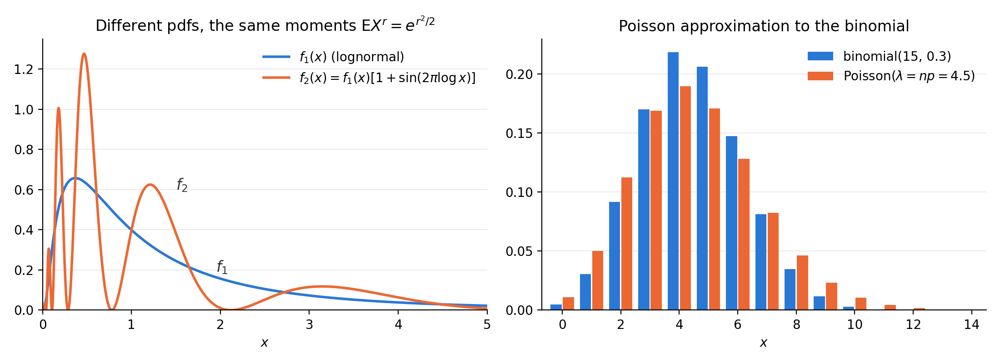

# Week 5: Moments, Mgfs, and Differentiating Under an Integral Sign

**Reading:** Casella & Berger (C&B) §§2.3–2.4

| Lecture | Date | Topics | C&B |
|---|---|---|---|
| **5.1** | Tue. Oct. 27 | Moments and central moments; variance; the moment generating function (mgf); generating moments from the mgf; the mgf of $aX + b$ | §2.3 |
| **5.2** | Thu. Oct. 29 | What the mgf determines: nonunique moments, uniqueness and convergence of mgfs, the Poisson approximation; differentiating under an integral sign | §§2.3–2.4 |

**Notation.**

- $\mu'_n = \mathrm{E}X^n$ is the $n$th moment, and $\mu_n = \mathrm{E}(X - \mu)^n$ is the $n$th central moment, where $\mu = \mathrm{E}X$.
- $\mathrm{Var}\, X$ is the variance of $X$.
- $M_X(t) = \mathrm{E}e^{tX}$ is the moment generating function (mgf) of $X$, and $M_X^{(n)}(0)$ is its $n$th derivative at $t = 0$.
- $\Gamma(\alpha)$ is the gamma function. For a positive integer $n$, $\Gamma(n) = (n - 1)!$ (more in §3.3).

**Where we are.** In Week 4 we defined $\mathrm{E}\,g(X)$ and found that $\mathrm{E}X$ is the best constant predictor of $X$. This week asks:

1. How spread out is $X$ around $\mathrm{E}X$? (the variance)
2. Is there one function that holds *all* the moments $\mathrm{E}X^n$ at once, and does it determine the distribution? (the mgf)
3. When may we move $\frac{d}{dt}$ inside an integral or a sum, as we will do to get moments from the mgf? (§2.4)

---

# Moments and Moment Generating Functions

> **Way of thinking.** The mgf packs all the moments into one function. Expand $e^{tX} = \sum_{n=0}^{\infty} \frac{t^n X^n}{n!}$ and take expectations: $M_X(t) = \sum_{n=0}^{\infty} \mathrm{E}X^n \, \frac{t^n}{n!}$. The moments are the Taylor coefficients.

## 1. Moments and variance

The various moments of a distribution are an important class of expectations.

**Definition 2.3.1.** For each integer $n$, the **$n$th moment** of $X$ (or $F_X(x)$), $\mu'_n$, is

$$
\mu'_n = \mathrm{E}X^n.
$$

The **$n$th central moment** of $X$, $\mu_n$, is

$$
\mu_n = \mathrm{E}(X - \mu)^n,
$$

where $\mu = \mu'_1 = \mathrm{E}X$.

Aside from the mean, $\mathrm{E}X$, of a random variable, perhaps the most important moment is the second central moment, more commonly known as the variance.

**Definition 2.3.2.** The **variance** of a random variable $X$ is its second central moment, $\mathrm{Var}\, X = \mathrm{E}(X - \mathrm{E}X)^2$. The positive square root of $\mathrm{Var}\, X$ is the **standard deviation** of $X$.

The variance measures the degree of spread of a distribution around its mean.

- In Example 2.2.6, $\mathrm{E}(X - b)^2$ is minimized by $b = \mathrm{E}X$. The variance is the size of that minimum.
- Larger values mean $X$ is more variable. At the extreme, if $\mathrm{Var}\, X = \mathrm{E}(X - \mathrm{E}X)^2 = 0$, then $X$ is equal to $\mathrm{E}X$ with probability 1, and there is no variation in $X$.
- The standard deviation has the same qualitative interpretation. It is easier to interpret because its measurement unit is the same as that of $X$; the unit of the variance is the square of the original unit.

**Example 2.3.3 (Exponential variance).** Let $X$ have the exponential($\lambda$) distribution, defined in Example 2.2.2. There we calculated $\mathrm{E}X = \lambda$, and we can now calculate the variance by

$$
\begin{aligned}
\mathrm{Var}\, X = \mathrm{E}(X - \lambda)^2 &= \int_0^{\infty} (x - \lambda)^2 \frac{1}{\lambda} e^{-x/\lambda}\, dx \\
&= \int_0^{\infty} (x^2 - 2x\lambda + \lambda^2) \frac{1}{\lambda} e^{-x/\lambda}\, dx.
\end{aligned}
$$

Integrating each term separately, using integration by parts on the terms involving $x$ and $x^2$, we find that $\mathrm{Var}\, X = \lambda^2$.

- So the variance of an exponential is directly related to the parameter $\lambda$.
- C&B Figure 2.3.1 plots the exponential pdf for $\lambda = 1, \frac{1}{3}, \frac{1}{5}$: the distribution is more concentrated about its mean for smaller values of $\lambda$.

**Theorem 2.3.4.** If $X$ is a random variable with finite variance, then for any constants $a$ and $b$,

$$
\mathrm{Var}(aX + b) = a^2\, \mathrm{Var}\, X.
$$

**Proof.** From the definition, we have

$$
\begin{aligned}
\mathrm{Var}(aX + b) &= \mathrm{E}\big( (aX + b) - \mathrm{E}(aX + b) \big)^2 \\
&= \mathrm{E}(aX - a\mathrm{E}X)^2 && (\mathrm{E}(aX + b) = a\mathrm{E}X + b) \\
&= a^2 \mathrm{E}(X - \mathrm{E}X)^2 \\
&= a^2\, \mathrm{Var}\, X. && \square
\end{aligned}
$$

- Shifting by $b$ does not change the spread.
- Rescaling by $a$ multiplies the variance by $a^2$ and the standard deviation by $\lvert a \rvert$.

It is sometimes easier to use an alternative formula for the variance,

$$
\mathrm{Var}\, X = \mathrm{E}X^2 - (\mathrm{E}X)^2, \tag{2.3.1}
$$

which is easily established by noting

$$
\begin{aligned}
\mathrm{Var}\, X = \mathrm{E}(X - \mathrm{E}X)^2 &= \mathrm{E}\big[ X^2 - 2X\mathrm{E}X + (\mathrm{E}X)^2 \big] \\
&= \mathrm{E}X^2 - 2(\mathrm{E}X)^2 + (\mathrm{E}X)^2 \\
&= \mathrm{E}X^2 - (\mathrm{E}X)^2,
\end{aligned}
$$

where we use the fact that $\mathrm{E}(X\mathrm{E}X) = (\mathrm{E}X)(\mathrm{E}X) = (\mathrm{E}X)^2$, since $\mathrm{E}X$ is a constant.

*Check with Example 2.3.3:* $\mathrm{E}X^2 = \int_0^{\infty} x^2 \frac{1}{\lambda} e^{-x/\lambda}\, dx = 2\lambda^2$ (two integrations by parts), so $\mathrm{Var}\, X = 2\lambda^2 - \lambda^2 = \lambda^2$.

**Example 2.3.5 (Binomial variance).** Let $X \sim$ binomial($n$, $p$), that is,

$$
P(X = x) = \binom{n}{x} p^x (1 - p)^{n - x}, \quad x = 0, 1, \dots, n.
$$

We have previously seen that $\mathrm{E}X = np$. To calculate $\mathrm{Var}\, X$ we first calculate $\mathrm{E}X^2$. We have

$$
\mathrm{E}X^2 = \sum_{x=0}^{n} x^2 \binom{n}{x} p^x (1 - p)^{n - x}. \tag{2.3.2}
$$

In order to sum this series, we must first manipulate the binomial coefficient in a manner similar to that used for $\mathrm{E}X$ (Example 2.2.3). We write

$$
x^2 \binom{n}{x} = x \frac{n!}{(x - 1)!\,(n - x)!} = xn \binom{n - 1}{x - 1}. \tag{2.3.3}
$$

The summand in (2.3.2) corresponding to $x = 0$ is 0, and using (2.3.3), we have

$$
\begin{aligned}
\mathrm{E}X^2 &= n \sum_{x=1}^{n} x \binom{n-1}{x-1} p^x (1-p)^{n-x} \\
&= n \sum_{y=0}^{n-1} (y + 1) \binom{n-1}{y} p^{y+1} (1-p)^{n-1-y} && (\text{setting } y = x - 1) \\
&= np \sum_{y=0}^{n-1} y \binom{n-1}{y} p^{y} (1-p)^{n-1-y} \\
&\qquad + np \sum_{y=0}^{n-1} \binom{n-1}{y} p^{y} (1-p)^{n-1-y}.
\end{aligned}
$$

- The first sum is equal to $(n - 1)p$, since it is the mean of a binomial($n - 1$, $p$).
- The second sum is equal to 1, since it is the total of a binomial($n - 1$, $p$) pmf.

Hence,

$$
\mathrm{E}X^2 = n(n-1)p^2 + np. \tag{2.3.4}
$$

Using (2.3.1), we have

$$
\mathrm{Var}\, X = n(n-1)p^2 + np - (np)^2 = -np^2 + np = np(1 - p).
$$

Calculation of higher moments proceeds in an analogous manner, but usually the mathematical manipulations become quite involved. In applications, moments of order 3 or 4 are sometimes of interest (skewness and kurtosis; see Exercise 2.28), but there is usually little statistical reason for examining higher moments than these.

## 2. The moment generating function

The **moment generating function** (mgf) is a new function associated with a probability distribution. As its name suggests, the mgf can be used to generate moments.

- In practice, it is easier in many cases to calculate moments directly than to use the mgf.
- The main use of the mgf is not to generate moments, but to help in **characterizing a distribution**. This property can lead to some extremely powerful results when used properly.

**Definition 2.3.6.** Let $X$ be a random variable with cdf $F_X$. The **moment generating function (mgf)** of $X$ (or $F_X$), denoted by $M_X(t)$, is

$$
M_X(t) = \mathrm{E}e^{tX},
$$

provided that the expectation exists for $t$ in some neighborhood of 0. That is, there is an $h > 0$ such that, for all $t$ in $-h < t < h$, $\mathrm{E}e^{tX}$ exists. If the expectation does not exist in a neighborhood of 0, we say that the moment generating function does not exist.

More explicitly, we can write the mgf of $X$ as

$$
M_X(t) = \int_{-\infty}^{\infty} e^{tx} f_X(x)\, dx \quad \text{if } X \text{ is continuous},
$$

or

$$
M_X(t) = \sum_x e^{tx} P(X = x) \quad \text{if } X \text{ is discrete}.
$$

Two things to notice:

- $M_X(0) = \mathrm{E}e^{0} = 1$ always. The question is whether $\mathrm{E}e^{tX}$ is finite for $t$ *near* 0, on both sides.
- $M_X$ is a function of the dummy variable $t$, not of $x$. All the information about $X$ enters through $f_X$.

**Theorem 2.3.7.** If $X$ has mgf $M_X(t)$, then

$$
\mathrm{E}X^n = M_X^{(n)}(0),
$$

where we define

$$
M_X^{(n)}(0) = \left. \frac{d^n}{dt^n} M_X(t) \right\rvert_{t=0}.
$$

That is, the $n$th moment is equal to the $n$th derivative of $M_X(t)$ evaluated at $t = 0$.

**Proof.** Assuming that we can differentiate under the integral sign (see §2.4, Lecture 5.2), we have

$$
\begin{aligned}
\frac{d}{dt} M_X(t) &= \frac{d}{dt} \int_{-\infty}^{\infty} e^{tx} f_X(x)\, dx \\
&= \int_{-\infty}^{\infty} \left( \frac{d}{dt} e^{tx} \right) f_X(x)\, dx \\
&= \int_{-\infty}^{\infty} (x e^{tx}) f_X(x)\, dx \\
&= \mathrm{E}Xe^{tX}.
\end{aligned}
$$

Thus,

$$
\left. \frac{d}{dt} M_X(t) \right\rvert_{t=0} = \left. \mathrm{E}Xe^{tX} \right\rvert_{t=0} = \mathrm{E}X.
$$

Proceeding in an analogous manner, we can establish that

$$
\left. \frac{d^n}{dt^n} M_X(t) \right\rvert_{t=0} = \left. \mathrm{E}X^n e^{tX} \right\rvert_{t=0} = \mathrm{E}X^n. \quad \square
$$

**Example 2.3.8 (Gamma mgf).** In Example 2.1.6 we encountered a special case of the **gamma pdf**,

$$
f(x) = \frac{1}{\Gamma(\alpha)\beta^{\alpha}} x^{\alpha - 1} e^{-x/\beta}, \quad 0 < x < \infty, \quad \alpha > 0, \quad \beta > 0,
$$

where $\Gamma(\alpha)$ denotes the gamma function, some of whose properties are given in Section 3.3. (Example 2.1.6 is the case $\alpha = n$, with $\Gamma(n) = (n - 1)!$.) The mgf is given by

$$
\begin{aligned}
M_X(t) &= \frac{1}{\Gamma(\alpha)\beta^{\alpha}} \int_0^{\infty} e^{tx} x^{\alpha - 1} e^{-x/\beta}\, dx \\
&= \frac{1}{\Gamma(\alpha)\beta^{\alpha}} \int_0^{\infty} x^{\alpha - 1} e^{-\left( \frac{1}{\beta} - t \right) x}\, dx \\
&= \frac{1}{\Gamma(\alpha)\beta^{\alpha}} \int_0^{\infty} x^{\alpha - 1} e^{-x / \left( \frac{\beta}{1 - \beta t} \right)}\, dx.
\end{aligned}
\tag{2.3.5}
$$

We now recognize the integrand in (2.3.5) as the **kernel** of another gamma pdf. (The kernel of a function is the main part of the function, the part that remains when constants are disregarded.) Using the fact that, for any positive constants $a$ and $b$,

$$
f(x) = \frac{1}{\Gamma(a) b^{a}} x^{a - 1} e^{-x/b}
$$

is a pdf, we have that

$$
\int_0^{\infty} \frac{1}{\Gamma(a) b^{a}} x^{a - 1} e^{-x/b}\, dx = 1
$$

and, hence,

$$
\int_0^{\infty} x^{a - 1} e^{-x/b}\, dx = \Gamma(a) b^{a}. \tag{2.3.6}
$$

Applying (2.3.6) to (2.3.5) with $a = \alpha$ and $b = \beta/(1 - \beta t)$, we have

$$
M_X(t) = \frac{1}{\Gamma(\alpha)\beta^{\alpha}} \Gamma(\alpha) \left( \frac{\beta}{1 - \beta t} \right)^{\alpha} = \left( \frac{1}{1 - \beta t} \right)^{\alpha} \quad \text{if } t < \frac{1}{\beta}.
$$

- If $t \ge 1/\beta$, then the quantity $(1/\beta) - t$ in the integrand of (2.3.5) is nonpositive, and the integral is infinite.
- Thus, the mgf of the gamma distribution exists only if $t < 1/\beta$. That is still a neighborhood of 0, so the mgf exists in the sense of Definition 2.3.6.

The mean of the gamma distribution is given by

$$
\mathrm{E}X = \left. \frac{d}{dt} M_X(t) \right\rvert_{t=0} = \left. \frac{\alpha\beta}{(1 - \beta t)^{\alpha + 1}} \right\rvert_{t=0} = \alpha\beta.
$$

Other moments can be calculated in a similar manner.

**The kernel trick** is worth remembering: to evaluate an integral, multiply and divide by the constant that turns the integrand into a known pdf, which integrates to 1. We used the same idea for the binomial mean in Example 2.2.3.

**Example 2.3.9 (Binomial mgf).** For a second illustration of calculating a moment generating function, we consider a discrete distribution, the binomial distribution. The binomial($n$, $p$) pmf is given in (2.1.3). So

$$
M_X(t) = \sum_{x=0}^{n} e^{tx} \binom{n}{x} p^x (1-p)^{n-x} = \sum_{x=0}^{n} \binom{n}{x} (pe^t)^x (1-p)^{n-x}.
$$

The binomial formula (see Theorem 3.2.2) gives

$$
\sum_{x=0}^{n} \binom{n}{x} u^x v^{n-x} = (u + v)^n. \tag{2.3.7}
$$

Hence, letting $u = pe^t$ and $v = 1 - p$, we have

$$
M_X(t) = \big[ pe^t + (1 - p) \big]^n.
$$

This mgf exists for **all** $t$.

## 3. The mgf of a linear transformation

C&B close §2.3 with the following useful result. We state it here, because it is a computational tool like Theorem 2.3.4.

**Theorem 2.3.15.** For any constants $a$ and $b$, the mgf of the random variable $aX + b$ is given by

$$
M_{aX+b}(t) = e^{bt} M_X(at).
$$

**Proof.** By definition,

$$
\begin{aligned}
M_{aX+b}(t) &= \mathrm{E}\left( e^{(aX + b)t} \right) \\
&= \mathrm{E}\left( e^{(aX)t} e^{bt} \right) && (\text{properties of exponentials}) \\
&= e^{bt} \mathrm{E}\left( e^{(at)X} \right) && (e^{bt} \text{ is constant}) \\
&= e^{bt} M_X(at), && (\text{definition of mgf})
\end{aligned}
$$

proving the theorem. $\square$

- The shift $b$ contributes the factor $e^{bt}$.
- The scale $a$ changes the argument: $M_X$ is evaluated at $at$, not at $t$.
- Compare Theorem 2.3.4: $\mathrm{Var}(aX + b) = a^2 \mathrm{Var}\, X$.

**Check your understanding.**

1. Let $X \sim$ uniform(0, 1). Find $\mathrm{E}X^2$, $\mathrm{Var}\, X$, and $\mathrm{Var}(3X + 2)$.

   

   
Show answer

   $\mathrm{E}X = \frac{1}{2}$ and $\mathrm{E}X^2 = \int_0^1 x^2\, dx = \frac{1}{3}$, so by (2.3.1), $\mathrm{Var}\, X = \frac{1}{3} - \frac{1}{4} = \frac{1}{12}$. By Theorem 2.3.4, $\mathrm{Var}(3X + 2) = 9 \cdot \frac{1}{12} = \frac{3}{4}$. The "$+2$" plays no role.

   

2. The exponential($\lambda$) distribution is the gamma distribution with $\alpha = 1$ and $\beta = \lambda$. Write down its mgf, say where it exists, and use Theorem 2.3.7 to find $\mathrm{E}X$, $\mathrm{E}X^2$, and $\mathrm{Var}\, X$. Compare with Example 2.3.3.

   

   
Show answer

   From Example 2.3.8, $M_X(t) = (1 - \lambda t)^{-1}$ for $t < 1/\lambda$. Then $M_X'(t) = \lambda (1 - \lambda t)^{-2}$ and $M_X''(t) = 2\lambda^2 (1 - \lambda t)^{-3}$, so $\mathrm{E}X = M_X'(0) = \lambda$ and $\mathrm{E}X^2 = M_X''(0) = 2\lambda^2$. Hence $\mathrm{Var}\, X = 2\lambda^2 - \lambda^2 = \lambda^2$, as in Example 2.3.3, with no integration by parts.

   

3. Let $X \sim$ binomial($n$, $p$) and $Y = n - X$. Use Theorem 2.3.15 to find $M_Y(t)$. What does it suggest about the distribution of $Y$? (Compare Example 2.1.1.)

   

   
Show answer

   With $a = -1$ and $b = n$:

   $$
   M_Y(t) = e^{nt} M_X(-t) = e^{nt} \big[ pe^{-t} + (1 - p) \big]^n = \big[ p + (1 - p)e^t \big]^n.
   $$

   This is the binomial($n$, $1 - p$) mgf from Example 2.3.9, with $p$ replaced by $1 - p$. Example 2.1.1 found the same answer from the pmf. Theorem 2.3.11 (Lecture 5.2) says that matching mgfs are enough to conclude $Y \sim$ binomial($n$, $1 - p$).

   

---

# What the Mgf Determines

> **Summary.** Moments describe a distribution; the mgf *identifies* it. To show two distributions are the same, or that a sequence of distributions converges, compare their mgfs near $t = 0$.

## 4. Moments do not always determine a distribution

As previously mentioned, the major usefulness of the moment generating function is not in its ability to generate moments. Rather, its usefulness stems from the fact that, in many cases, the moment generating function can characterize a distribution.

- If the mgf exists, it characterizes an infinite set of moments.
- The natural question is whether characterizing the infinite set of moments uniquely determines a distribution function.
- The answer to this question, unfortunately, is **no**. Characterizing the set of moments is not enough to determine a distribution uniquely because there may be two distinct random variables having the same moments.

**Example 2.3.10 (Nonunique moments).** Consider the two pdfs given by

$$
\begin{aligned}
f_1(x) &= \frac{1}{\sqrt{2\pi}\, x} e^{-(\log x)^2/2}, && 0 \le x < \infty, \\
f_2(x) &= f_1(x)\big[ 1 + \sin(2\pi \log x) \big], && 0 \le x < \infty.
\end{aligned}
$$

(The pdf $f_1$ is a special case of a **lognormal pdf**.) It can be shown that if $X_1 \sim f_1(x)$, then

$$
\mathrm{E}X_1^r = e^{r^2/2}, \quad r = 0, 1, \dots,
$$

so $X_1$ has all of its moments. Now suppose that $X_2 \sim f_2(x)$. We have

$$
\begin{aligned}
\mathrm{E}X_2^r &= \int_0^{\infty} x^r f_1(x) \big[ 1 + \sin(2\pi \log x) \big]\, dx \\
&= \mathrm{E}X_1^r + \int_0^{\infty} x^r f_1(x) \sin(2\pi \log x)\, dx.
\end{aligned}
$$

However, the transformation $y = \log x - r$ shows that this last integral is that of an odd function over $(-\infty, \infty)$ and hence is equal to 0 for $r = 0, 1, \dots$. Thus, even though $X_1$ and $X_2$ have distinct pdfs, they have the same moments for all $r$. (See Exercise 2.35 for details, and Exercises 2.34, 2.36, and 2.37 for more about mgfs and distributions.)

{: style="max-width:100%; height:auto;"}

**Figure.**

- **Left (Example 2.3.10):** $f_1$ and $f_2$ look nothing alike, yet $\mathrm{E}X_1^r = \mathrm{E}X_2^r = e^{r^2/2}$ for every $r$. The moments $e^{r^2/2}$ grow so fast that the lognormal has **no mgf** (Exercise 2.36), so Theorem 2.3.11(b) below does not apply.
- **Right (Example 2.3.13):** the binomial(15, 0.3) pmf next to the Poisson pmf with $\lambda = np = 4.5$. The largest difference in any single probability is about 0.035.

When does the problem go away?

- It does not occur if the random variables have **bounded support**. Then the infinite sequence of moments does uniquely determine the distribution (see, for example, Billingsley 1995, Section 30).
- If the **mgf exists** in a neighborhood of 0, then the distribution is uniquely determined, no matter what its support.
- Thus, existence of all moments is **not** equivalent to existence of the moment generating function.

## 5. Uniqueness and convergence of mgfs

**Theorem 2.3.11.** Let $F_X(x)$ and $F_Y(y)$ be two cdfs all of whose moments exist.

- **a.** If $X$ and $Y$ have bounded support, then $F_X(u) = F_Y(u)$ for all $u$ if and only if $\mathrm{E}X^r = \mathrm{E}Y^r$ for all integers $r = 0, 1, 2, \dots$.
- **b.** If the moment generating functions exist and $M_X(t) = M_Y(t)$ for all $t$ in some neighborhood of 0, then $F_X(u) = F_Y(u)$ for all $u$.

In the next theorem, which deals with a sequence of mgfs that converges, we do not treat the bounded support case separately.

**Theorem 2.3.12 (Convergence of mgfs).** Suppose $\lbrace X_i, i = 1, 2, \dots \rbrace$ is a sequence of random variables, each with mgf $M_{X_i}(t)$. Furthermore, suppose that

$$
\lim_{i \to \infty} M_{X_i}(t) = M_X(t), \quad \text{for all } t \text{ in a neighborhood of } 0,
$$

and $M_X(t)$ is an mgf. Then there is a unique cdf $F_X$ whose moments are determined by $M_X(t)$ and, for all $x$ where $F_X(x)$ is continuous, we have

$$
\lim_{i \to \infty} F_{X_i}(x) = F_X(x).
$$

That is, convergence, for $\lvert t \rvert < h$, of mgfs to an mgf implies convergence of cdfs.

**Why these are reasonable.** The proofs rely on the theory of **Laplace transforms**. The defining equation

$$
M_X(t) = \int_{-\infty}^{\infty} e^{tx} f_X(x)\, dx \tag{2.3.8}
$$

says that $M_X(t)$ is the Laplace transform of $f_X(x)$. 

- A key fact about Laplace transforms is their **uniqueness**: if (2.3.8) is valid for all $t$ such that $\lvert t \rvert < h$, then given $M_X(t)$ there is only one function $f_X(x)$ that satisfies (2.3.8). 

- The rigorous proofs are technical and provide no real understanding, so C&B omit them, and so do we.

**How to use them.**

- Theorem 2.3.11(b): to identify a distribution, compute its mgf and recognize it.
- Theorem 2.3.12: convergence of mgfs in a neighborhood of 0 is a **sufficient**, but not necessary, condition for the sequence of random variables to converge.
- Convergence of moments alone is not enough, because of the possible nonuniqueness of the moment sequence (Miscellanea 2.6.1).

**Example 2.3.13 (Poisson approximation).** Binomial probabilities (see Example 2.3.5) can be approximated by **Poisson** probabilities, which are generally easier to calculate. The binomial distribution is characterized by two quantities, $n$ and $p$. It is taught that the Poisson approximation is valid "when $n$ is large and $np$ is small," and rules of thumb are sometimes given.

The Poisson($\lambda$) pmf is given by

$$
P(X = x) = \frac{e^{-\lambda} \lambda^x}{x!}, \quad x = 0, 1, 2, \dots,
$$

where $\lambda$ is a positive constant. The approximation states that if $X \sim$ binomial($n$, $p$) and $Y \sim$ Poisson($\lambda$), with $\lambda = np$, then

$$
P(X = x) \approx P(Y = x) \tag{2.3.9}
$$

for large $n$ and small $np$. We now show that the mgfs converge, lending credence to this approximation. Recall that

$$
M_X(t) = \big[ pe^t + (1 - p) \big]^n. \tag{2.3.10}
$$

For the Poisson($\lambda$) distribution, we can calculate (see Exercise 2.33)

$$
M_Y(t) = e^{\lambda(e^t - 1)},
$$

and if we define $p = \lambda/n$, then $M_X(t) \to M_Y(t)$ as $n \to \infty$. The validity of the approximation in (2.3.9) will then follow from Theorem 2.3.12.

We first need an important limit result, one that has wide applicability in statistics. Its proof may be found in many standard calculus texts.

**Lemma 2.3.14.** Let $a_1, a_2, \dots$ be a sequence of numbers converging to $a$, that is, $\lim_{n \to \infty} a_n = a$. Then

$$
\lim_{n \to \infty} \left( 1 + \frac{a_n}{n} \right)^n = e^{a}.
$$

Returning to the example, we have

$$
\begin{aligned}
M_X(t) = \big[ pe^t + (1 - p) \big]^n &= \left[ 1 + \frac{1}{n} (e^t - 1)(np) \right]^n \\
&= \left[ 1 + \frac{1}{n} (e^t - 1)\lambda \right]^n,
\end{aligned}
$$

because $\lambda = np$. Now set $a_n = a = (e^t - 1)\lambda$, and apply Lemma 2.3.14 to get

$$
\lim_{n \to \infty} M_X(t) = e^{\lambda(e^t - 1)} = M_Y(t),
$$

the moment generating function of the Poisson.

The Poisson approximation can be quite good even for moderate $p$ and $n$: the right panel of the figure above shows $n = 15$, $p = 0.3$ (C&B Figure 2.3.3).

## 6. Existence of mgf and moments

A useful order to keep in mind is

$$
\text{mgf exists} \;\Rightarrow\; \text{all moments finite} \;\Rightarrow\; \mathrm{Var}\, X < \infty \;\Rightarrow\; \mathrm{E}X \text{ exists},
$$

and none of these arrows can be reversed. The examples below fail at each level in turn.

**Level 1: the mean does not exist.**

- **Cauchy,** $f(x) = \frac{1}{\pi(1 + x^2)}$ (Example 2.2.4). $\mathrm{E}\lvert X \rvert = \infty$, and both tails are infinite, so $\mathrm{E}X$ would be $\infty - \infty$, which is undefined. This happens even though the pdf is symmetric about 0.
- **Pareto-type,** $f(x) = \frac{1}{x^2}$, $x > 1$. $\mathrm{E}X = \int_1^{\infty} \frac{dx}{x} = \infty$, so the mean is infinite.
- **$1/U$ with $U \sim$ uniform(0, 1).** $\mathrm{E}(1/U) = \int_0^1 \frac{du}{u} = \infty$. In fact $1/U$ has exactly the pdf $1/x^2$ on $x > 1$ from the previous example.
- **A discrete example:** $P(X = k) = \frac{1}{k(k + 1)}$, $k = 1, 2, \dots$ (HW2 Problem 9). $\mathrm{E}X = \sum_k \frac{1}{k + 1} = \infty$, the harmonic series.
- **St. Petersburg:** $P(X = 2^k) = 2^{-k}$, $k = 1, 2, \dots$ Then $\mathrm{E}X = \sum_k 2^k \cdot 2^{-k} = \sum_k 1 = \infty$. This is the classic "how much would you pay to play?" paradox.

**Level 2: the mean exists but the variance does not.**

- $f(y) = \frac{2}{y^3}$, $y > 1$ (the high-water mark $Y$ in Week 4 Discussion Problem 1). $\mathrm{E}Y = \int_1^{\infty} \frac{2}{y^2}\, dy = 2$, but $\mathrm{E}Y^2 = \int_1^{\infty} \frac{2}{y}\, dy = \infty$.
- Student's $t$ with 2 degrees of freedom (Chapter 5): $\mathrm{E}X = 0$, but $\mathrm{Var}\, X = \infty$.
- **General pattern.** If $f(x) \approx c/x^{\alpha + 1}$ for large $x$, then $\mathrm{E}\lvert X \rvert^k < \infty$ exactly when $k < \alpha$. The heavier the tail, the fewer moments exist.

**Level 3: all moments exist but the mgf does not.**

- **Lognormal** (Example 2.3.10, Exercise 2.36), with $\log X \sim \mathrm{n}(0, 1)$. Every moment $\mathrm{E}X^r = e^{r^2/2}$ is finite. But $\mathrm{E}e^{tX} = \infty$ for every $t > 0$, because $e^{tx}$ outgrows the tail $e^{-(\log x)^2/2}$.
- $f(x) = \frac{1}{2} e^{-\sqrt{x}}$, $x > 0$. Substituting $u = \sqrt{x}$ gives $\mathrm{E}X^n = (2n + 1)!$, which is finite. But for $t > 0$, $e^{tx - \sqrt{x}} \to \infty$ as $x \to \infty$, so $\mathrm{E}e^{tX} = \infty$.
- In both examples $\mathrm{E}e^{tX}$ is finite for $t \le 0$ but infinite for every $t > 0$. Definition 2.3.6 requires finiteness on a whole interval $(-h, h)$, so having only one side doesn't count.
- By contrast, the exponential passes: its mgf $(1 - \lambda t)^{-1}$ is finite only for $t < 1/\lambda$, but that set contains a neighborhood of 0.

**Why "mgf exists $\Rightarrow$ all moments exist."** Fix $t$ with $0 < t < h$. For any $n$ and any $x$,

$$
\frac{\lvert tx \rvert^n}{n!} \le e^{\lvert tx \rvert} \le e^{tx} + e^{-tx}.
$$

Taking expectations,

$$
\mathrm{E}\lvert X \rvert^n \le \frac{n!}{t^n} \big( M_X(t) + M_X(-t) \big) < \infty.
$$

- So an mgf forces the tails of $X$ to decay at least exponentially fast.
- That is also why the lognormal, which has every moment, still has no mgf: its tail decays more slowly than any exponential.
- *Looking ahead:* the **characteristic function** $\mathrm{E}e^{itX}$ (with $i = \sqrt{-1}$) always exists, since $\lvert e^{itX} \rvert = 1$, even for the Cauchy. This is why advanced courses use it in place of the mgf.

---

# Differentiating Under an Integral Sign

> **Way of thinking.** A derivative is a limit, so moving $\frac{d}{d\theta}$ inside $\int$ or $\sum$ means swapping a limit with an integral or a sum. That swap is safe when the integrand is **dominated** by one integrable function that does not depend on the parameter.

## 7. Leibniz's Rule

In the proof of Theorem 2.3.7 we interchanged the order of integration and differentiation. This situation is encountered frequently in theoretical statistics. The purpose of this section is to characterize conditions under which this operation is legitimate. We will also discuss interchanging the order of differentiation and summation. Detailed proofs are in most calculus textbooks and are not presented here.

We first want to establish the method of calculating

$$
\frac{d}{d\theta} \int_{a(\theta)}^{b(\theta)} f(x, \theta)\, dx, \tag{2.4.1}
$$

where $-\infty < a(\theta), b(\theta) < \infty$ for all $\theta$. The rule for differentiating (2.4.1) is called **Leibniz's Rule** and is an application of the Fundamental Theorem of Calculus and the chain rule.

**Theorem 2.4.1 (Leibniz's Rule).** If $f(x, \theta)$, $a(\theta)$, and $b(\theta)$ are differentiable with respect to $\theta$, then

$$
\begin{aligned}
\frac{d}{d\theta} \int_{a(\theta)}^{b(\theta)} f(x, \theta)\, dx
&= f(b(\theta), \theta) \frac{d}{d\theta} b(\theta) - f(a(\theta), \theta) \frac{d}{d\theta} a(\theta) \\
&\qquad + \int_{a(\theta)}^{b(\theta)} \frac{\partial}{\partial \theta} f(x, \theta)\, dx.
\end{aligned}
$$

Reading the three terms:

- The first two terms come from the moving limits (Fundamental Theorem of Calculus and the chain rule).
- The last term comes from the integrand changing with $\theta$.

Notice that if $a(\theta)$ and $b(\theta)$ are constant, we have a special case of Leibniz's Rule:

$$
\frac{d}{d\theta} \int_a^b f(x, \theta)\, dx = \int_a^b \frac{\partial}{\partial \theta} f(x, \theta)\, dx.
$$

Thus, in general, if we have the integral of a differentiable function over a **finite** range, differentiation of the integral poses no problem. If the range of integration is **infinite**, however, problems can arise.

- The interchange equates a partial derivative with an ordinary derivative. This must be so: the left-hand side is a function of only $\theta$, while the integrand on the right-hand side is a function of both $\theta$ and $x$.

## 8. Interchanging limits and integrals

The question of whether interchanging the order of differentiation and integration is justified is really a question of whether **limits and integration** can be interchanged, since a derivative is a special kind of limit. Recall that if $f(x, \theta)$ is differentiable, then

$$
\frac{\partial}{\partial \theta} f(x, \theta) = \lim_{\delta \to 0} \frac{f(x, \theta + \delta) - f(x, \theta)}{\delta},
$$

so we have

$$
\int_{-\infty}^{\infty} \frac{\partial}{\partial \theta} f(x, \theta)\, dx = \int_{-\infty}^{\infty} \lim_{\delta \to 0} \left[ \frac{f(x, \theta + \delta) - f(x, \theta)}{\delta} \right] dx,
$$

while

$$
\frac{d}{d\theta} \int_{-\infty}^{\infty} f(x, \theta)\, dx = \lim_{\delta \to 0} \int_{-\infty}^{\infty} \left[ \frac{f(x, \theta + \delta) - f(x, \theta)}{\delta} \right] dx.
$$

Treating this problem in full generality needs measure theory, which C&B (and we) do not cover. The following theorems are all corollaries of **Lebesgue's Dominated Convergence Theorem** (see, for example, Rudin 1976).

**Theorem 2.4.2.** Suppose the function $h(x, y)$ is continuous at $y_0$ for each $x$, and there exists a function $g(x)$ satisfying

- **i.** $\lvert h(x, y) \rvert \le g(x)$ for all $x$ and $y$,
- **ii.** $\int_{-\infty}^{\infty} g(x)\, dx < \infty$.

Then

$$
\lim_{y \to y_0} \int_{-\infty}^{\infty} h(x, y)\, dx = \int_{-\infty}^{\infty} \lim_{y \to y_0} h(x, y)\, dx.
$$

The key condition in this theorem is the existence of a **dominating function** $g(x)$, with a finite integral, which ensures that the integrals cannot be too badly behaved. We now apply this theorem with $h(x, y)$ replaced by the difference quotient $\big( f(x, \theta + \delta) - f(x, \theta) \big)/\delta$.

**Theorem 2.4.3.** Suppose $f(x, \theta)$ is differentiable at $\theta = \theta_0$, that is,

$$
\lim_{\delta \to 0} \frac{f(x, \theta_0 + \delta) - f(x, \theta_0)}{\delta} = \left. \frac{\partial}{\partial \theta} f(x, \theta) \right\rvert_{\theta = \theta_0}
$$

exists for every $x$, and there exists a function $g(x, \theta_0)$ and a constant $\delta_0 > 0$ such that

- **i.** $\left\lvert \dfrac{f(x, \theta_0 + \delta) - f(x, \theta_0)}{\delta} \right\rvert \le g(x, \theta_0)$, for all $x$ and $\lvert \delta \rvert \le \delta_0$,
- **ii.** $\int_{-\infty}^{\infty} g(x, \theta_0)\, dx < \infty$.

Then

$$
\left. \frac{d}{d\theta} \int_{-\infty}^{\infty} f(x, \theta)\, dx \right\rvert_{\theta = \theta_0} = \int_{-\infty}^{\infty} \left[ \left. \frac{\partial}{\partial \theta} f(x, \theta) \right\rvert_{\theta = \theta_0} \right] dx. \tag{2.4.2}
$$

Comments on the theorem:

- Condition (i) is similar to a **Lipschitz condition**, which imposes smoothness on a function. Here it effectively bounds the variability in the first derivative.
- The statement is for **one value** $\theta_0$: for each $\theta_0$ at which $f(x, \theta)$ is differentiable and (i) and (ii) hold, the order of integration and differentiation can be interchanged.
- Often the distinction between $\theta$ and $\theta_0$ is not stressed, and (2.4.2) is written

  $$
  \frac{d}{d\theta} \int_{-\infty}^{\infty} f(x, \theta)\, dx = \int_{-\infty}^{\infty} \frac{\partial}{\partial \theta} f(x, \theta)\, dx. \tag{2.4.3}
  $$

**An easier condition to check.** Typically, $f(x, \theta)$ is differentiable at all $\theta$, not at just one value $\theta_0$. Then, by the mean value theorem, for fixed $x$ and $\theta_0$, and $\lvert \delta \rvert \le \delta_0$,

$$
\frac{f(x, \theta_0 + \delta) - f(x, \theta_0)}{\delta} = \left. \frac{\partial}{\partial \theta} f(x, \theta) \right\rvert_{\theta = \theta_0 + \delta^{\ast}(x)}
$$

for some number $\delta^{\ast}(x)$, where $\lvert \delta^{\ast}(x) \rvert \le \delta_0$. Therefore, condition (i) will be satisfied if we find a $g(x, \theta)$ that satisfies condition (ii) and

$$
\left\lvert \left. \frac{\partial}{\partial \theta} f(x, \theta) \right\rvert_{\theta = \theta'} \right\rvert \le g(x, \theta) \quad \text{for all } \theta' \text{ such that } \lvert \theta' - \theta \rvert \le \delta_0. \tag{2.4.4}
$$

Note that in (2.4.4) $\delta_0$ is implicitly a function of $\theta$, as is the case in Theorem 2.4.3. This is permitted since the theorem is applied to each value of $\theta$ individually. From (2.4.4) we get the following corollary.

**Corollary 2.4.4.** Suppose $f(x, \theta)$ is differentiable in $\theta$ and there exists a function $g(x, \theta)$ such that (2.4.4) is satisfied and $\int_{-\infty}^{\infty} g(x, \theta)\, dx < \infty$. Then (2.4.3) holds.

Both condition (i) of Theorem 2.4.3 and (2.4.4) impose a **uniformity** requirement on the functions to be bounded: one $g$ must work for all nearby parameter values at once. Some type of uniformity is generally needed before derivatives and integrals can be interchanged.

**The recipe** for Corollary 2.4.4:

1. Compute $\frac{\partial}{\partial \theta} f(x, \theta)$ and bound its absolute value.
2. Replace $\theta$ by the "worst" value in $[\theta - \delta_0, \theta + \delta_0]$, to get a bound $g(x, \theta)$ that holds for all $\theta'$ in that interval.
3. Check that $\int g(x, \theta)\, dx < \infty$.

**Example 2.4.5 (Interchanging integration and differentiation–I).** Let $X$ have the exponential($\lambda$) pdf given by $f(x) = (1/\lambda) e^{-x/\lambda}$, $0 < x < \infty$, and suppose we want to calculate

$$
\frac{d}{d\lambda} \mathrm{E}X^n = \frac{d}{d\lambda} \int_0^{\infty} x^n \left( \frac{1}{\lambda} \right) e^{-x/\lambda}\, dx \tag{2.4.5}
$$

for integer $n > 0$. If we could move the differentiation inside the integral, we would have

$$
\begin{aligned}
\frac{d}{d\lambda} \mathrm{E}X^n &= \int_0^{\infty} \frac{\partial}{\partial \lambda} x^n \left( \frac{1}{\lambda} \right) e^{-x/\lambda}\, dx \\
&= \int_0^{\infty} \frac{x^n}{\lambda^2} \left( \frac{x}{\lambda} - 1 \right) e^{-x/\lambda}\, dx \\
&= \frac{1}{\lambda^2} \mathrm{E}X^{n+1} - \frac{1}{\lambda} \mathrm{E}X^n.
\end{aligned}
\tag{2.4.6}
$$

To justify the interchange of integration and differentiation, we bound the derivative of $x^n (1/\lambda) e^{-x/\lambda}$. Now, since $x/\lambda > 0$,

$$
\left\lvert \frac{\partial}{\partial \lambda} \left( \frac{x^n e^{-x/\lambda}}{\lambda} \right) \right\rvert = \frac{x^n e^{-x/\lambda}}{\lambda^2} \left\lvert \frac{x}{\lambda} - 1 \right\rvert \le \frac{x^n e^{-x/\lambda}}{\lambda^2} \left( \frac{x}{\lambda} + 1 \right).
$$

For some constant $\delta_0$ satisfying $0 < \delta_0 < \lambda$, take

$$
g(x, \lambda) = \frac{x^n e^{-x/(\lambda + \delta_0)}}{(\lambda - \delta_0)^2} \left( \frac{x}{\lambda - \delta_0} + 1 \right).
$$

We then have

$$
\left\lvert \left. \frac{\partial}{\partial \lambda} \left( \frac{x^n e^{-x/\lambda}}{\lambda} \right) \right\rvert_{\lambda = \lambda'} \right\rvert \le g(x, \lambda) \quad \text{for all } \lambda' \text{ such that } \lvert \lambda' - \lambda \rvert \le \delta_0.
$$

- In $g$, each $\lambda$ was replaced by its worst case: $\lambda - \delta_0$ in the denominators, which makes them small, and $\lambda + \delta_0$ in the exponent, which makes the decay slowest.
- Since the exponential distribution has all of its moments, $\int_{-\infty}^{\infty} g(x, \lambda)\, dx < \infty$ as long as $\lambda - \delta_0 > 0$, so the interchange of integration and differentiation is justified.

Notice that (2.4.6) gives us a **recursion relation** for the moments of the exponential distribution,

$$
\mathrm{E}X^{n+1} = \lambda \mathrm{E}X^n + \lambda^2 \frac{d}{d\lambda} \mathrm{E}X^n, \tag{2.4.7}
$$

making the calculation of the $(n + 1)$st moment relatively easy. This type of relationship exists for other distributions. In particular, if $X$ has a normal distribution with mean $\mu$ and variance 1, so it has pdf $f(x) = (1/\sqrt{2\pi}) e^{-(x - \mu)^2/2}$, then

$$
\mathrm{E}X^{n+1} = \mu \mathrm{E}X^n - \frac{d}{d\mu} \mathrm{E}X^n.
$$

The property illustrated for the exponential distribution holds for a large class of densities, which will be dealt with in Section 3.4 (exponential families).

**Example 2.4.6 (Interchanging integration and differentiation–II).** *(Reading; we sketch the idea in class.)* Again let $X$ have a normal distribution with mean $\mu$ and variance 1, and consider the mgf of $X$,

$$
M_X(t) = \mathrm{E}e^{tX} = \frac{1}{\sqrt{2\pi}} \int_{-\infty}^{\infty} e^{tx} e^{-(x - \mu)^2/2}\, dx.
$$

In §2.3 we computed moments by differentiating $M_X(t)$, assuming that differentiation under the integral sign was justified:

$$
\frac{d}{dt} M_X(t) = \frac{d}{dt} \mathrm{E}e^{tX} = \mathrm{E}\frac{\partial}{\partial t} e^{tX} = \mathrm{E}(Xe^{tX}). \tag{2.4.8}
$$

Here $t$ plays the role of $\theta$ in Theorem 2.4.3, and $\mu$ is treated as a constant. From Corollary 2.4.4, we must find a function $g(x, t)$, with finite integral, that satisfies

$$
\left\lvert \left. \frac{\partial}{\partial t} e^{tx} e^{-(x - \mu)^2/2} \right\rvert_{t = t'} \right\rvert \le g(x, t) \quad \text{for all } t' \text{ such that } \lvert t' - t \rvert \le \delta_0. \tag{2.4.9}
$$

Doing the obvious, we have

$$
\left\lvert \frac{\partial}{\partial t} e^{tx} e^{-(x - \mu)^2/2} \right\rvert = \left\lvert x e^{tx} e^{-(x - \mu)^2/2} \right\rvert \le \lvert x \rvert e^{tx} e^{-(x - \mu)^2/2}.
$$

It is easiest to define $g(x, t)$ separately for $x \ge 0$ and $x < 0$. We take

$$
g(x, t) =
\begin{cases}
\lvert x \rvert e^{(t - \delta_0)x} e^{-(x - \mu)^2/2} & \text{if } x < 0 \\
\lvert x \rvert e^{(t + \delta_0)x} e^{-(x - \mu)^2/2} & \text{if } x \ge 0.
\end{cases}
$$

This satisfies (2.4.9). To see that its integral is finite, complete the square in the exponent. For $x \ge 0$,

$$
g(x, t) = x e^{-[x - (\mu + t + \delta_0)]^2/2} \, e^{-[\mu^2 - (\mu + t + \delta_0)^2]/2},
$$

so $\int_0^{\infty} g(x, t)\, dx$ is, up to a constant, part of the mean of a normal distribution with mean $\mu + t + \delta_0$, which is finite (Chapter 3). A similar development for $x < 0$ shows that $\int_{-\infty}^0 g(x, t)\, dx < \infty$. Therefore the operation in (2.4.8) is justified.

## 9. Interchanging differentiation and summation

We now turn to interchanging differentiation and summation, an operation that plays an important role in discrete distributions. Of course, we are concerned only with **infinite** sums, since a derivative can always be taken inside a finite sum.

**Example 2.4.7 (Interchanging summation and differentiation).** Let $X$ be a discrete random variable with the **geometric distribution**

$$
P(X = x) = \theta(1 - \theta)^x, \quad x = 0, 1, \dots, \quad 0 < \theta < 1.
$$

We have that $\sum_{x=0}^{\infty} \theta(1 - \theta)^x = 1$ and, provided that the operations are justified,

$$
\begin{aligned}
\frac{d}{d\theta} \sum_{x=0}^{\infty} \theta(1 - \theta)^x &= \sum_{x=0}^{\infty} \frac{d}{d\theta} \theta(1 - \theta)^x \\
&= \sum_{x=0}^{\infty} \big[ (1 - \theta)^x - \theta x (1 - \theta)^{x-1} \big] \\
&= \frac{1}{\theta} \sum_{x=0}^{\infty} \theta(1 - \theta)^x - \frac{1}{1 - \theta} \sum_{x=0}^{\infty} x \theta (1 - \theta)^x.
\end{aligned}
$$

Since $\sum_{x=0}^{\infty} \theta(1 - \theta)^x = 1$ for all $0 < \theta < 1$, its derivative is 0. So we have

$$
\frac{1}{\theta} \sum_{x=0}^{\infty} \theta(1 - \theta)^x - \frac{1}{1 - \theta} \sum_{x=0}^{\infty} x \theta (1 - \theta)^x = 0. \tag{2.4.10}
$$

Now the first sum in (2.4.10) is equal to 1 and the second sum is $\mathrm{E}X$; hence (2.4.10) becomes

$$
\frac{1}{\theta} - \frac{1}{1 - \theta} \mathrm{E}X = 0, \quad \text{or} \quad \mathrm{E}X = \frac{1 - \theta}{\theta}.
$$

We have, in essence, summed the series $\sum_{x=0}^{\infty} x\theta(1 - \theta)^x$ by differentiating.

**The trick in words:** differentiate the identity "total probability $= 1$" with respect to the parameter. The derivative of a constant is 0, and the result is an equation for a moment.

Justification for taking the derivative inside the summation is more straightforward than the integration case. The following theorem provides the details.

**Theorem 2.4.8.** Suppose that the series $\sum_{x=0}^{\infty} h(\theta, x)$ converges for all $\theta$ in an interval $(a, b)$ of real numbers and

- **i.** $\frac{\partial}{\partial \theta} h(\theta, x)$ is continuous in $\theta$ for each $x$,
- **ii.** $\sum_{x=0}^{\infty} \frac{\partial}{\partial \theta} h(\theta, x)$ converges uniformly on every closed bounded subinterval of $(a, b)$.

Then

$$
\frac{d}{d\theta} \sum_{x=0}^{\infty} h(\theta, x) = \sum_{x=0}^{\infty} \frac{\partial}{\partial \theta} h(\theta, x). \tag{2.4.11}
$$

The condition of **uniform convergence** is the key one to verify. Recall that a series converges uniformly if its sequence of partial sums converges uniformly.

**Example 2.4.9 (Continuation of Example 2.4.7).** To apply Theorem 2.4.8 we identify

$$
h(\theta, x) = \theta(1 - \theta)^x \quad \text{and} \quad \frac{\partial}{\partial \theta} h(\theta, x) = (1 - \theta)^x - \theta x (1 - \theta)^{x-1},
$$

and verify that $\sum_{x=0}^{\infty} \frac{\partial}{\partial \theta} h(\theta, x)$ converges uniformly. Define $S_n(\theta)$ by

$$
S_n(\theta) = \sum_{x=0}^{n} \big[ (1 - \theta)^x - \theta x (1 - \theta)^{x-1} \big].
$$

The convergence will be uniform on $[c, d] \subset (0, 1)$ if, given $\epsilon > 0$, we can find an $N$ such that

$$
n > N \Rightarrow \lvert S_n(\theta) - S_{\infty}(\theta) \rvert < \epsilon \quad \text{for all } \theta \in [c, d].
$$

Using the partial sum of the geometric series (1.5.3), and pulling a derivative through a *finite* sum (which is always allowed), C&B show that

$$
S_n(\theta) = (n + 1)(1 - \theta)^n.
$$

So $S_{\infty}(\theta) = \lim_{n \to \infty} S_n(\theta) = 0$ for $0 < \theta < 1$. The convergence is uniform on $[c, d]$ because, for every $\theta \in [c, d]$,

$$
0 \le S_n(\theta) \le (n + 1)(1 - c)^n \to 0,
$$

a bound that does not depend on $\theta$. Therefore the series of derivatives converges uniformly, and the interchange of differentiation and summation is justified. (The closed interval matters: near $\theta = 0$ the convergence is not uniform.)

We close this section with a theorem that is similar to Theorem 2.4.8, but treats the case of interchanging the order of summation and integration.

**Theorem 2.4.10.** Suppose the series $\sum_{x=0}^{\infty} h(\theta, x)$ converges uniformly on $[a, b]$ and that, for each $x$, $h(\theta, x)$ is a continuous function of $\theta$. Then

$$
\int_a^b \sum_{x=0}^{\infty} h(\theta, x)\, d\theta = \sum_{x=0}^{\infty} \int_a^b h(\theta, x)\, d\theta.
$$

**Check your understanding.**

1. A random variable $X$ has mgf $M_X(t) = e^{3(e^t - 1)}$ for all $t$. What is the distribution of $X$? Find $P(X = 0)$ and $\mathrm{E}X$.

   

   
Show answer

   This is the Poisson mgf $e^{\lambda(e^t - 1)}$ with $\lambda = 3$, and it exists for all $t$. By Theorem 2.3.11(b), $X \sim$ Poisson(3). So $P(X = 0) = e^{-3} \approx 0.050$, and $\mathrm{E}X = M_X'(0) = 3e^t \cdot e^{3(e^t - 1)} \big\rvert_{t=0} = 3$.

   

2. Use Leibniz's Rule to find $\frac{d}{d\theta} \int_0^{\theta^2} e^{-\theta x}\, dx$ for $\theta > 0$. Check your answer by computing the integral first.

   

   
Show answer

   With $f(x, \theta) = e^{-\theta x}$, $a(\theta) = 0$, and $b(\theta) = \theta^2$:

   $$
   \begin{aligned}
   \frac{d}{d\theta} \int_0^{\theta^2} e^{-\theta x}\, dx &= e^{-\theta^3} \cdot 2\theta - 0 + \int_0^{\theta^2} (-x) e^{-\theta x}\, dx \\
   &= 2\theta e^{-\theta^3} - \frac{1 - e^{-\theta^3}(1 + \theta^3)}{\theta^2} \\
   &= 3\theta e^{-\theta^3} - \frac{1 - e^{-\theta^3}}{\theta^2}.
   \end{aligned}
   $$

   *Check:* $\int_0^{\theta^2} e^{-\theta x}\, dx = \frac{1 - e^{-\theta^3}}{\theta}$, and the quotient rule gives the same derivative. The limits are finite, so no domination argument is needed.

   

3. Use the recursion (2.4.7) to find $\mathrm{E}X^2$ and $\mathrm{E}X^3$ for $X \sim$ exponential($\lambda$). Guess the general formula for $\mathrm{E}X^n$.

   

   
Show answer

   Start from $\mathrm{E}X = \lambda$:

   - $\mathrm{E}X^2 = \lambda \cdot \lambda + \lambda^2 \cdot \frac{d}{d\lambda} \lambda = 2\lambda^2$.
   - $\mathrm{E}X^3 = \lambda \cdot 2\lambda^2 + \lambda^2 \cdot \frac{d}{d\lambda} 2\lambda^2 = 2\lambda^3 + 4\lambda^3 = 6\lambda^3$.

   The pattern is $\mathrm{E}X^n = n!\, \lambda^n$, which follows by induction from (2.4.7). It agrees with Check your understanding 2 of Lecture 5.1 for $n = 2$.

   

---

## Summary of Week 5

- **Moments:** $\mu'_n = \mathrm{E}X^n$ and $\mu_n = \mathrm{E}(X - \mu)^n$ (Definition 2.3.1). **Variance:** $\mathrm{Var}\, X = \mathrm{E}(X - \mathrm{E}X)^2 = \mathrm{E}X^2 - (\mathrm{E}X)^2$ (Definition 2.3.2, (2.3.1)), and $\mathrm{Var}(aX + b) = a^2 \mathrm{Var}\, X$ (Theorem 2.3.4).
- **Mgf:** $M_X(t) = \mathrm{E}e^{tX}$, which must exist for $t$ in a neighborhood of 0 (Definition 2.3.6). Moments: $\mathrm{E}X^n = M_X^{(n)}(0)$ (Theorem 2.3.7). Linear transformations: $M_{aX+b}(t) = e^{bt} M_X(at)$ (Theorem 2.3.15).
- **Examples:** exponential variance $\lambda^2$; binomial variance $np(1 - p)$; gamma mgf $(1 - \beta t)^{-\alpha}$, $t < 1/\beta$; binomial mgf $[pe^t + (1 - p)]^n$; Poisson mgf $e^{\lambda(e^t - 1)}$.
- **What the mgf determines:** moments alone may not determine a distribution (Example 2.3.10), but an mgf that exists near 0 does (Theorem 2.3.11). Convergence of mgfs implies convergence of cdfs (Theorem 2.3.12), which gives the Poisson approximation to the binomial (Example 2.3.13).
- **Existence:** mgf exists $\Rightarrow$ all moments finite $\Rightarrow$ $\mathrm{Var}\, X < \infty$ $\Rightarrow$ $\mathrm{E}X$ exists, and no arrow reverses: Cauchy (no mean), $f(y) = 2/y^3$ (mean but no variance), lognormal (all moments but no mgf).
- **Differentiating under an integral sign:** finite limits are handled by Leibniz's Rule (Theorem 2.4.1). For infinite ranges, find a dominating function $g$ with $\int g < \infty$ (Theorem 2.4.3, Corollary 2.4.4). For infinite sums, check uniform convergence of the series of derivatives (Theorem 2.4.8).

## A video

[A video](https://www.youtube.com/watch?v=bl8Z7Dl7P9A&list=LL&index=1)

## Practice Problems

From C&B §2.5:

- **Moments and variance:** 2.22, 2.23, 2.24, 2.28, 2.29(a, b).
- **Moment generating functions:** 2.25, 2.30, 2.32, 2.33.
- **Uniqueness and convergence of mgfs:** 2.34, 2.35, 2.36, 2.38.
- **Differentiating under an integral sign:** 2.39, 2.40.

**Next week:** midterm review (Tue. Nov. 3) and the midterm examination (Thu. Nov. 5), covering Chapters 1–2.
