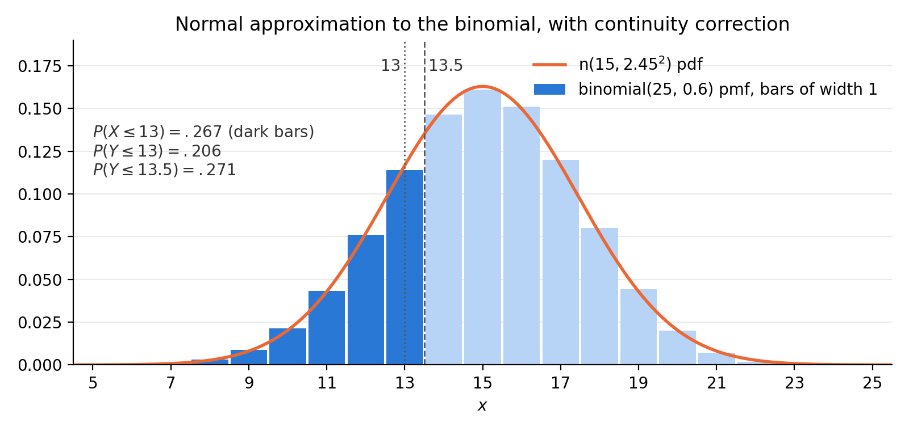
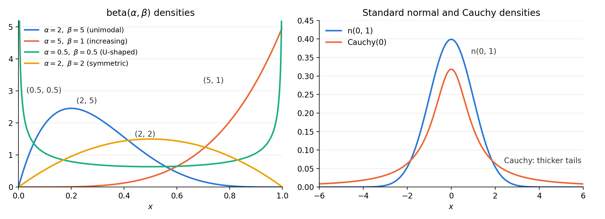

# Week 6: Common Families of Distributions

**Reading:** Casella & Berger (C&B) §§3.1–3.3

| Lecture | Date | Topics | C&B |
|---|---|---|---|
| **6.1** | Tue. Nov. 10 | Parametric families; discrete families: discrete uniform, hypergeometric, binomial, Poisson, negative binomial, geometric | §§3.1–3.2 |
| **6.2** | Thu. Nov. 12 | Continuous families: uniform, gamma and exponential, $\chi^2$, normal, beta, Cauchy; the normal approximation | §3.3 |

**Notation.**

- Parameters are written after a "$\mid$" (read "given"): $P(X = x \mid N)$, $f(x \mid \alpha, \beta)$. When there is no possibility of confusion, the parameters are omitted.
- $X \sim$ binomial($n$, $p$) means "$X$ has the binomial($n$, $p$) distribution."
- $\mathrm{n}(\mu, \sigma^2)$ is the normal distribution with mean $\mu$ and variance $\sigma^2$ (C&B's notation).
- $\Gamma(\alpha) = \int_0^{\infty} t^{\alpha - 1} e^{-t}\, dt$ is the gamma function, and $B(\alpha, \beta)$ is the beta function (§10).

**Where we are.** Chapters 1–2 (and the midterm) built the tools: pmfs and pdfs, transformations, $\mathrm{E}X$, $\mathrm{Var}\, X$, and mgfs. Chapter 3 applies them to the distributions that statisticians actually use. For each family we ask:

1. **The story.** What experiment produces it?
2. **The pmf or pdf**, with its support and parameter space.
3. **The mean, variance, and mgf.**
4. **The relationships.** Which families are special cases or limits of others?

---

# Discrete Families

> **Way of thinking.** Know each family by its **story**: draws without replacement (hypergeometric), a fixed number of independent trials (binomial), counts of rare events (Poisson), waiting for successes (negative binomial, geometric). To find the moments, **recognize the sum as another member of the same family**, so that it equals 1.

## 1. Parametric families

Statistical distributions are used to model populations; as such, we usually deal with a family of distributions rather than a single distribution.

- This family is indexed by one or more **parameters**, which allow us to vary certain characteristics of the distribution while staying with one functional form.
- For example, we may specify that the normal distribution is a reasonable choice to model a particular population, but we cannot precisely specify the mean. Then, we deal with a parametric family, normal distributions with mean $\mu$, where $\mu$ is an unspecified parameter, $-\infty < \mu < \infty$.
- For each distribution we give its mean and variance, typical applications, and some interesting and useful interrelationships. Many of these facts are summarized in the tables at the end of C&B and in the summary at the end of these notes.

A random variable $X$ is said to have a **discrete distribution** if the range of $X$, the sample space, is countable. In most situations, the random variable has integer-valued outcomes.

## 2. Discrete uniform distribution

A random variable $X$ has a **discrete uniform$(1, N)$ distribution** if

$$
P(X = x \mid N) = \frac{1}{N}, \quad x = 1, 2, \dots, N, \tag{3.2.1}
$$

where $N$ is a specified integer. This distribution puts equal mass on each of the outcomes $1, 2, \dots, N$.

To calculate the mean and variance of $X$, recall the identities (provable by induction)

$$
\sum_{i=1}^{k} i = \frac{k(k + 1)}{2} \quad \text{and} \quad \sum_{i=1}^{k} i^2 = \frac{k(k + 1)(2k + 1)}{6}.
$$

We then have

$$
\mathrm{E}X = \sum_{x=1}^{N} x P(X = x \mid N) = \sum_{x=1}^{N} x \frac{1}{N} = \frac{N + 1}{2}
$$

and

$$
\mathrm{E}X^2 = \sum_{x=1}^{N} x^2 \frac{1}{N} = \frac{(N + 1)(2N + 1)}{6},
$$

and so

$$
\begin{aligned}
\mathrm{Var}\, X &= \mathrm{E}X^2 - (\mathrm{E}X)^2 \\
&= \frac{(N + 1)(2N + 1)}{6} - \left( \frac{N + 1}{2} \right)^2 \\
&= \frac{(N + 1)(N - 1)}{12}.
\end{aligned}
$$

- This distribution can be generalized so that the sample space is any range of integers, $N_0, N_0 + 1, \dots, N_1$, with pmf $P(X = x \mid N_0, N_1) = 1/(N_1 - N_0 + 1)$.

## 3. Hypergeometric distribution

The hypergeometric distribution has many applications in finite population sampling and is best understood through the classic example of the **urn model**.

- Suppose we have a large urn filled with $N$ balls that are identical in every way except that $M$ are red and $N - M$ are green.
- We reach in, blindfolded, and select $K$ balls at random (the $K$ balls are taken all at once, a case of **sampling without replacement**).
- What is the probability that exactly $x$ of the balls are red?

The total number of samples of size $K$ that can be drawn from the $N$ balls is $\binom{N}{K}$, as was discussed in Section 1.2.3. It is required that $x$ of the balls be red, and this can be accomplished in $\binom{M}{x}$ ways, leaving $\binom{N - M}{K - x}$ ways of filling out the sample with $K - x$ green balls. Thus, if we let $X$ denote the number of red balls in a sample of size $K$, then $X$ has a **hypergeometric distribution** given by

$$
P(X = x \mid N, M, K) = \frac{\binom{M}{x} \binom{N - M}{K - x}}{\binom{N}{K}}, \quad x = 0, 1, \dots, K. \tag{3.2.2}
$$

Note that there is, implicit in (3.2.2), an additional assumption on the range of $X$.

- Binomial coefficients of the form $\binom{n}{r}$ have been defined only if $n \ge r$, and so the range of $X$ is additionally restricted by the pair of inequalities

  $$
  M \ge x \quad \text{and} \quad N - M \ge K - x,
  $$

  which can be combined as

  $$
  M - (N - K) \le x \le M.
  $$

- In many cases $K$ is small compared to $M$ and $N$, so the range $0 \le x \le K$ will be contained in the above range and, hence, will be appropriate.
- The formula for the hypergeometric probability function is usually quite difficult to deal with. In fact, it is not even trivial to verify that $\sum_{x=0}^{K} P(X = x) = 1$.

**The mean.** The mean of the hypergeometric distribution is given by

$$
\mathrm{E}X = \sum_{x=0}^{K} x \frac{\binom{M}{x} \binom{N - M}{K - x}}{\binom{N}{K}} = \sum_{x=1}^{K} x \frac{\binom{M}{x} \binom{N - M}{K - x}}{\binom{N}{K}}. \quad (\text{summand is 0 at } x = 0)
$$

To evaluate this expression, we use the identities (already encountered in Section 2.3)

$$
x \binom{M}{x} = M \binom{M - 1}{x - 1}, \qquad \binom{N}{K} = \frac{N}{K} \binom{N - 1}{K - 1},
$$

and obtain

$$
\mathrm{E}X = \sum_{x=1}^{K} \frac{M \binom{M - 1}{x - 1} \binom{N - M}{K - x}}{\frac{N}{K} \binom{N - 1}{K - 1}} = \frac{KM}{N} \sum_{x=1}^{K} \frac{\binom{M - 1}{x - 1} \binom{N - M}{K - x}}{\binom{N - 1}{K - 1}}.
$$

We now can recognize the second sum above as the sum of the probabilities for another hypergeometric distribution based on parameter values $N - 1$, $M - 1$, and $K - 1$. This can be seen clearly by defining $y = x - 1$ and writing

$$
\begin{aligned}
\sum_{x=1}^{K} \frac{\binom{M - 1}{x - 1} \binom{N - M}{K - x}}{\binom{N - 1}{K - 1}}
&= \sum_{y=0}^{K - 1} \frac{\binom{M - 1}{y} \binom{(N - 1) - (M - 1)}{K - 1 - y}}{\binom{N - 1}{K - 1}} \\
&= \sum_{y=0}^{K - 1} P(Y = y \mid N - 1, M - 1, K - 1) = 1,
\end{aligned}
$$

where $Y$ is a hypergeometric random variable with parameters $N - 1$, $M - 1$, and $K - 1$. Therefore, for the hypergeometric distribution,

$$
\mathrm{E}X = \frac{KM}{N}.
$$

A similar, but more lengthy, calculation will establish that

$$
\mathrm{Var}\, X = \frac{KM}{N} \left( \frac{(N - M)(N - K)}{N(N - 1)} \right).
$$

- Note the manipulations used here to calculate $\mathrm{E}X$. The sum was transformed to another hypergeometric distribution with different parameter values and, by recognizing this fact, we were able to sum the series.
- **Interpretation.** Each draw is red with probability $p = M/N$, so $\mathrm{E}X = Kp$, as for a binomial($K$, $p$). The variance is $Kp(1 - p) \cdot \frac{N - K}{N - 1}$. The extra factor $\frac{N - K}{N - 1} < 1$ (the **finite population correction**) is the price of sampling without replacement. It is close to 1 when $N$ is large compared with $K$.

**Example 3.2.1 (Acceptance sampling).** The hypergeometric distribution has application in acceptance sampling, as this example will illustrate. Suppose a retailer buys goods in lots and each item can be either acceptable or defective. Let

- $N$ = number of items in a lot,
- $M$ = number of defectives in a lot.

Then we can calculate the probability that a sample of size $K$ contains $x$ defectives. To be specific, suppose that a lot of 25 machine parts is delivered, where a part is considered acceptable only if it passes tolerance. We sample 10 parts and find that none are defective (all are within tolerance). What is the probability of this event if there are 6 defectives in the lot of 25? Applying the hypergeometric distribution with $N = 25$, $M = 6$, $K = 10$, we have

$$
P(X = 0) = \frac{\binom{6}{0} \binom{19}{10}}{\binom{25}{10}} = .028,
$$

showing that our observed event is quite unlikely if there are 6 (or more!) defectives in the lot.

## 4. Bernoulli and binomial distributions

The binomial distribution, one of the more useful discrete distributions, is based on the idea of a **Bernoulli trial**. A Bernoulli trial (named for James Bernoulli, one of the founding fathers of probability theory) is an experiment with two, and only two, possible outcomes. A random variable $X$ has a **Bernoulli($p$) distribution** if

$$
X =
\begin{cases}
1 & \text{with probability } p \\
0 & \text{with probability } 1 - p,
\end{cases}
\qquad 0 \le p \le 1. \tag{3.2.3}
$$

- The value $X = 1$ is often termed a "success" and $p$ is referred to as the success probability. The value $X = 0$ is termed a "failure."
- The mean and variance of a Bernoulli($p$) random variable are easily seen to be

  $$
  \begin{aligned}
  \mathrm{E}X &= 1p + 0(1 - p) = p, \\
  \mathrm{Var}\, X &= (1 - p)^2 p + (0 - p)^2 (1 - p) = p(1 - p).
  \end{aligned}
  $$

- Many experiments can be modeled as a sequence of Bernoulli trials: coin tossing ($p$ = probability of a head), gambling games (in roulette, $X = 1$ if red occurs), election polls ($X = 1$ if candidate A gets a vote), and incidence of a disease ($p$ = probability that a random person gets infected).

**From Bernoulli to binomial.** If $n$ identical Bernoulli trials are performed, define the events

$$
A_i = \lbrace X = 1 \text{ on the } i\text{th trial} \rbrace, \quad i = 1, 2, \dots, n.
$$

If we assume that the events $A_1, \dots, A_n$ are a collection of independent events (as is the case in coin tossing), it is then easy to derive the distribution of the total number of successes in $n$ trials. Define a random variable $Y$ by

$$
Y = \text{total number of successes in } n \text{ trials}.
$$

- The event $\lbrace Y = y \rbrace$ will occur only if, out of the events $A_1, \dots, A_n$, exactly $y$ of them occur, and necessarily $n - y$ of them do not occur.
- One particular outcome (one particular ordering of occurrences and nonoccurrences) of the $n$ Bernoulli trials might be $A_1 \cap A_2 \cap A_3^c \cap \cdots \cap A_{n-1} \cap A_n^c$. By independence, this has probability of occurrence

  $$
  P(A_1 \cap A_2 \cap A_3^c \cap \cdots \cap A_{n-1} \cap A_n^c) = p^y (1 - p)^{n - y}.
  $$

- The calculation is not dependent on which set of $y$ $A_i$s occurs, only that some set of $y$ occurs. Since there are $\binom{n}{y}$ such sequences (the number of orderings of $y$ 1s and $n - y$ 0s), we have

$$
P(Y = y \mid n, p) = \binom{n}{y} p^y (1 - p)^{n - y}, \quad y = 0, 1, 2, \dots, n,
$$

and $Y$ is called a **binomial($n$, $p$) random variable**.

The random variable $Y$ can be alternatively, and equivalently, defined in the following way: In a sequence of $n$ identical, independent Bernoulli trials, each with success probability $p$, define the random variables $X_1, \dots, X_n$ by

$$
X_i =
\begin{cases}
1 & \text{with probability } p \\
0 & \text{with probability } 1 - p.
\end{cases}
$$

The random variable

$$
Y = \sum_{i=1}^{n} X_i
$$

has the binomial($n$, $p$) distribution. The fact that $\sum_{y=0}^{n} P(Y = y) = 1$ follows from the following general theorem.

**Theorem 3.2.2 (Binomial Theorem).** For any real numbers $x$ and $y$ and integer $n \ge 0$,

$$
(x + y)^n = \sum_{i=0}^{n} \binom{n}{i} x^i y^{n - i}. \tag{3.2.4}
$$

**Proof.** Write

$$
(x + y)^n = (x + y)(x + y) \cdots (x + y),
$$

and consider how the right-hand side would be calculated. From each factor $(x + y)$ we choose either an $x$ or $y$, and multiply together the $n$ choices. For each $i = 0, 1, \dots, n$, the number of such terms in which $x$ appears exactly $i$ times is $\binom{n}{i}$. Therefore, this term is of the form $\binom{n}{i} x^i y^{n - i}$ and the result follows. $\square$

- If we take $x = p$ and $y = 1 - p$ in (3.2.4), we get

  $$
  1 = (p + (1 - p))^n = \sum_{i=0}^{n} \binom{n}{i} p^i (1 - p)^{n - i},
  $$

  and we see that each term in the sum is a binomial probability.
- As another special case, take $x = y = 1$ in Theorem 3.2.2 and get the identity $2^n = \sum_{i=0}^{n} \binom{n}{i}$. (Compare HW1, Problem 4.)

The mean, variance, and mgf of the binomial distribution have already been derived in Examples 2.2.3, 2.3.5, and 2.3.9. For completeness, if $X \sim$ binomial($n$, $p$), then

$$
\mathrm{E}X = np, \qquad \mathrm{Var}\, X = np(1 - p), \qquad M_X(t) = \big[ pe^t + (1 - p) \big]^n.
$$

- With $Y = \sum X_i$, these are $n$ times the Bernoulli mean $p$ and variance $p(1 - p)$, and the mgf is the $n$th power of the Bernoulli mgf $pe^t + (1 - p)$. Chapter 4 explains why: the $X_i$ are independent.

**Example 3.2.3 (Dice probabilities).** Suppose we are interested in finding the probability of obtaining at least one 6 in four rolls of a fair die. This experiment can be modeled as a sequence of four Bernoulli trials with success probability $p = \frac{1}{6} = P(\text{die shows 6})$. Define the random variable $X$ by $X$ = total number of 6s in four rolls. Then $X \sim$ binomial$(4, \frac{1}{6})$ and

$$
\begin{aligned}
P(\text{at least one 6}) &= P(X > 0) = 1 - P(X = 0) \\
&= 1 - \binom{4}{0} \left( \frac{1}{6} \right)^0 \left( \frac{5}{6} \right)^4 \\
&= 1 - \left( \frac{5}{6} \right)^4 = .518.
\end{aligned}
$$

Now we consider another game: throw a pair of dice 24 times and ask for the probability of at least one double 6. This, again, can be modeled by the binomial distribution with success probability $p = P(\text{roll a double 6}) = \frac{1}{36}$. So, if $Y$ = number of double 6s in 24 rolls, $Y \sim$ binomial$(24, \frac{1}{36})$ and

$$
\begin{aligned}
P(\text{at least one double 6}) &= P(Y > 0) = 1 - P(Y = 0) \\
&= 1 - \binom{24}{0} \left( \frac{1}{36} \right)^0 \left( \frac{35}{36} \right)^{24} \\
&= 1 - \left( \frac{35}{36} \right)^{24} = .491.
\end{aligned}
$$

This is the calculation originally done in the eighteenth century by Pascal at the request of the gambler de Méré, who thought both events had the same probability. (He began to believe he was wrong when he started losing money on the second bet.)

## 5. Poisson distribution

The Poisson distribution is a widely applied discrete distribution and can serve as a model for a number of different types of experiments.

- **Waiting for occurrences.** If we are modeling a phenomenon in which we are waiting for an occurrence (such as waiting for a bus, waiting for customers to arrive in a bank), the number of occurrences in a given time interval can sometimes be modeled by the Poisson distribution.
- One of the basic assumptions on which the Poisson distribution is built is that, for small time intervals, the probability of an arrival is proportional to the length of waiting time. (See the Miscellanea section of C&B, §3.8, for a more formal treatment.)
- **Spatial distributions.** The Poisson may be used to model the distribution of bomb hits in an area or the distribution of fish in a lake.

The Poisson distribution has a single parameter $\lambda$, sometimes called the **intensity parameter**. A random variable $X$, taking values in the nonnegative integers, has a **Poisson($\lambda$) distribution** if

$$
P(X = x \mid \lambda) = \frac{e^{-\lambda} \lambda^x}{x!}, \quad x = 0, 1, \dots. \tag{3.2.5}
$$

To see that $\sum_{x=0}^{\infty} P(X = x \mid \lambda) = 1$, recall the Taylor series expansion of $e^y$,

$$
e^y = \sum_{i=0}^{\infty} \frac{y^i}{i!}.
$$

Thus,

$$
\sum_{x=0}^{\infty} P(X = x \mid \lambda) = e^{-\lambda} \sum_{x=0}^{\infty} \frac{\lambda^x}{x!} = e^{-\lambda} e^{\lambda} = 1.
$$

The mean of $X$ is easily seen to be

$$
\begin{aligned}
\mathrm{E}X &= \sum_{x=0}^{\infty} x \frac{e^{-\lambda} \lambda^x}{x!} = \sum_{x=1}^{\infty} x \frac{e^{-\lambda} \lambda^x}{x!} \\
&= \lambda e^{-\lambda} \sum_{x=1}^{\infty} \frac{\lambda^{x-1}}{(x - 1)!} \\
&= \lambda e^{-\lambda} \sum_{y=0}^{\infty} \frac{\lambda^y}{y!} && (\text{substitute } y = x - 1) \\
&= \lambda.
\end{aligned}
$$

A similar calculation will show that $\mathrm{Var}\, X = \lambda$, and so the parameter $\lambda$ is both the mean and the variance of the Poisson distribution. The mgf can also be obtained by a straightforward calculation, again following from the Taylor series of $e^y$. We have

$$
M_X(t) = e^{\lambda(e^t - 1)}.
$$

(See Exercise 2.33 and Example 2.3.13.)

**Example 3.2.4 (Waiting time).** As an example of a waiting-for-occurrence application, consider a telephone operator who, on the average, handles five calls every 3 minutes. What is the probability that there will be no calls in the next minute? At least two calls?

If we let $X$ = number of calls in a minute, then $X$ has a Poisson distribution with $\mathrm{E}X = \lambda = \frac{5}{3}$. So

$$
\begin{aligned}
P(\text{no calls in the next minute}) &= P(X = 0) \\
&= \frac{e^{-5/3} \left( \frac{5}{3} \right)^0}{0!} = e^{-5/3} = .189;
\end{aligned}
$$

$$
\begin{aligned}
P(\text{at least two calls in the next minute}) &= P(X \ge 2) \\
&= 1 - P(X = 0) - P(X = 1) \\
&= 1 - .189 - \frac{e^{-5/3} \left( \frac{5}{3} \right)^1}{1!} \\
&= .496.
\end{aligned}
$$

**Recursion relations.** Calculation of Poisson probabilities can be done rapidly by noting the following recursion relation:

$$
P(X = x) = \frac{\lambda}{x} P(X = x - 1), \quad x = 1, 2, \dots. \tag{3.2.6}
$$

This relation is easily proved by writing out the pmf of the Poisson. Similar relations hold for other discrete distributions. For example, if $Y \sim$ binomial($n$, $p$), then

$$
P(Y = y) = \frac{(n - y + 1)}{y} \frac{p}{1 - p} P(Y = y - 1). \tag{3.2.7}
$$

**The Poisson approximation to the binomial, again.** The recursion relations (3.2.6) and (3.2.7) can be used to establish the Poisson approximation to the binomial, which we have already seen in Section 2.3 (Example 2.3.13), where the approximation was justified using mgfs. Set $\lambda = np$ and, if $p$ is small, we can write

$$
\frac{n - y + 1}{y} \frac{p}{1 - p} = \frac{np - p(y - 1)}{y - py} \approx \frac{\lambda}{y},
$$

since, for small $p$, the terms $p(y - 1)$ and $py$ can be ignored. Therefore, to this level of approximation, (3.2.7) becomes

$$
P(Y = y) = \frac{\lambda}{y} P(Y = y - 1), \tag{3.2.8}
$$

which is the Poisson recursion relation. To complete the approximation, we need only establish that $P(X = 0) \approx P(Y = 0)$, since all other probabilities will follow from (3.2.8). Now

$$
P(Y = 0) = (1 - p)^n = \left( 1 - \frac{np}{n} \right)^n = \left( 1 - \frac{\lambda}{n} \right)^n
$$

upon setting $np = \lambda$. Recall from Section 2.3 (Lemma 2.3.14) that for fixed $\lambda$, $\lim_{n \to \infty} (1 - (\lambda/n))^n = e^{-\lambda}$, so for large $n$ we have the approximation

$$
P(Y = 0) = \left( 1 - \frac{\lambda}{n} \right)^n \approx e^{-\lambda} = P(X = 0),
$$

completing the Poisson approximation to the binomial.

- The approximation is valid when $n$ is large and $p$ is small, which is exactly when it is most useful, freeing us from calculation of binomial coefficients and powers for large $n$.

**Example 3.2.5 (Poisson approximation).** A typesetter, on the average, makes one error in every 500 words typeset. A typical page contains 300 words. What is the probability that there will be no more than two errors in five pages?

If we assume that setting a word is a Bernoulli trial with success probability $p = \frac{1}{500}$ (notice that we are labeling an error as a "success") and that the trials are independent, then $X$ = number of errors in five pages (1500 words) is binomial$(1500, \frac{1}{500})$. Thus

$$
\begin{aligned}
P(\text{no more than two errors}) &= P(X \le 2) \\
&= \sum_{x=0}^{2} \binom{1500}{x} \left( \frac{1}{500} \right)^x \left( \frac{499}{500} \right)^{1500 - x} \\
&= .4230,
\end{aligned}
$$

which is a fairly cumbersome calculation. If we use the Poisson approximation with $\lambda = 1500 \left( \frac{1}{500} \right) = 3$, we have

$$
P(X \le 2) \approx e^{-3} \left( 1 + 3 + \frac{3^2}{2} \right) = .4232.
$$

## 6. Negative binomial and geometric distributions

The binomial distribution counts the number of successes in a fixed number of Bernoulli trials. Suppose that, instead, we count the number of Bernoulli trials required to get a fixed number of successes. This latter formulation leads to the **negative binomial distribution**.

In a sequence of independent Bernoulli($p$) trials, let the random variable $X$ denote the trial at which the $r$th success occurs, where $r$ is a fixed integer. Then

$$
P(X = x \mid r, p) = \binom{x - 1}{r - 1} p^r (1 - p)^{x - r}, \quad x = r, r + 1, \dots, \tag{3.2.9}
$$

and we say that $X$ has a **negative binomial($r$, $p$) distribution**.

- **Derivation.** The event $\lbrace X = x \rbrace$ can occur only if there are exactly $r - 1$ successes in the first $x - 1$ trials, and a success on the $x$th trial.
  - The probability of $r - 1$ successes in $x - 1$ trials is the binomial probability $\binom{x - 1}{r - 1} p^{r - 1} (1 - p)^{x - r}$.
  - With probability $p$ there is a success on the $x$th trial.
  - Multiplying these probabilities gives (3.2.9).

**Counting failures instead.** The negative binomial distribution is sometimes defined in terms of the random variable $Y$ = number of failures before the $r$th success. This formulation is statistically equivalent to the one given above in terms of $X$ = trial at which the $r$th success occurs, since $Y = X - r$. Using the relationship between $Y$ and $X$, the alternative form of the negative binomial distribution is

$$
P(Y = y) = \binom{r + y - 1}{y} p^r (1 - p)^y, \quad y = 0, 1, \dots. \tag{3.2.10}
$$

Unless otherwise noted, when we refer to the negative binomial($r$, $p$) distribution we will use this pmf.

- **The name.** The negative binomial distribution gets its name from the relationship

  $$
  \begin{aligned}
  \binom{r + y - 1}{y} &= (-1)^y \binom{-r}{y} \\
  &= (-1)^y \frac{(-r)(-r - 1)(-r - 2) \cdots (-r - y + 1)}{(y)(y - 1)(y - 2) \cdots (2)(1)},
  \end{aligned}
  $$

  which is, in fact, the defining equation for binomial coefficients with negative integers. Substituting into (3.2.10) yields

  $$
  P(Y = y) = (-1)^y \binom{-r}{y} p^r (1 - p)^y,
  $$

  which bears a striking resemblance to the binomial distribution.
- The fact that $\sum_{y=0}^{\infty} P(Y = y) = 1$ is not easy to verify but follows from an extension of the Binomial Theorem, an extension that includes negative exponents.

**Mean and variance.** The mean and variance of $Y$ can be calculated using techniques similar to those used for the binomial distribution:

$$
\begin{aligned}
\mathrm{E}Y &= \sum_{y=0}^{\infty} y \binom{r + y - 1}{y} p^r (1 - p)^y \\
&= \sum_{y=1}^{\infty} \frac{(r + y - 1)!}{(y - 1)!\,(r - 1)!} p^r (1 - p)^y \\
&= \sum_{y=1}^{\infty} r \binom{r + y - 1}{y - 1} p^r (1 - p)^y.
\end{aligned}
$$

Now write $z = y - 1$, and the sum becomes

$$
\begin{aligned}
\mathrm{E}Y &= \sum_{z=0}^{\infty} r \binom{r + z}{z} p^r (1 - p)^{z + 1} \\
&= r \frac{(1 - p)}{p} \sum_{z=0}^{\infty} \binom{(r + 1) + z - 1}{z} p^{r + 1} (1 - p)^z \\
&= r \frac{(1 - p)}{p}.
\end{aligned}
$$

The summand in the second line is a negative binomial pmf. Since the sum is over all values of a negative binomial$(r + 1, p)$ distribution, it equals 1. A similar calculation will show

$$
\mathrm{Var}\, Y = \frac{r(1 - p)}{p^2}.
$$

- **Reparameterization by the mean.** If we define the parameter $\mu = r(1 - p)/p$, then $\mathrm{E}Y = \mu$ and a little algebra will show that

  $$
  \mathrm{Var}\, Y = \mu + \frac{1}{r} \mu^2.
  $$

  The variance is a quadratic function of the mean. This relationship can be useful in both data analysis and theoretical considerations (Morris 1982). Compare the Poisson, where $\mathrm{Var} = \mu$: the negative binomial is **overdispersed**.
- **Poisson as a limit.** The negative binomial family of distributions includes the Poisson distribution as a limiting case. If $r \to \infty$ and $p \to 1$ such that $r(1 - p) \to \lambda$, $0 < \lambda < \infty$, then

  $$
  \mathrm{E}Y = \frac{r(1 - p)}{p} \to \lambda, \qquad \mathrm{Var}\, Y = \frac{r(1 - p)}{p^2} \to \lambda,
  $$

  which agree with the Poisson mean and variance. To demonstrate that the negative binomial$(r, p) \to$ Poisson$(\lambda)$, we can show that all of the probabilities converge. The fact that the mgfs converge leads us to expect this (see Exercise 3.15).

**Example 3.2.6 (Inverse binomial sampling).** A technique known as inverse binomial sampling is useful in sampling biological populations. If the proportion of individuals possessing a certain characteristic is $p$ and we sample until we see $r$ such individuals, then the number of individuals sampled is a negative binomial random variable.

For example, suppose that in a population of fruit flies we are interested in the proportion having vestigial wings and decide to sample until we have found 100 such flies. The probability that we will have to examine at least $N$ flies is (using (3.2.9))

$$
\begin{aligned}
P(X \ge N) &= \sum_{x=N}^{\infty} \binom{x - 1}{99} p^{100} (1 - p)^{x - 100} \\
&= 1 - \sum_{x=100}^{N-1} \binom{x - 1}{99} p^{100} (1 - p)^{x - 100}.
\end{aligned}
$$

For given $p$ and $N$, we can evaluate this expression to determine how many fruit flies we are likely to look at. (Although the evaluation is cumbersome, the use of a recursion relation will speed things up.)

- Example 3.2.6 shows that the negative binomial distribution can, like the Poisson, be used to model phenomena in which we are waiting for an occurrence. In the negative binomial case we are waiting for a specified number of successes.

**Geometric distribution.** The geometric distribution is the simplest of the waiting time distributions and is a special case of the negative binomial distribution. If we set $r = 1$ in (3.2.9) we have

$$
P(X = x \mid p) = p(1 - p)^{x - 1}, \quad x = 1, 2, \dots,
$$

which defines the pmf of a **geometric random variable** $X$ with success probability $p$.

- $X$ can be interpreted as the trial at which the first success occurs, so we are "waiting for a success."
- The fact that $\sum_{x=1}^{\infty} P(X = x) = 1$ follows from properties of the geometric series. For any number $a$ with $\lvert a \rvert < 1$,

  $$
  \sum_{x=1}^{\infty} a^{x - 1} = \frac{1}{1 - a},
  $$

  which we have already encountered in Example 1.5.4.
- The mean and variance of $X$ can be calculated by using the negative binomial formulas and by writing $X = Y + 1$ to obtain

  $$
  \mathrm{E}X = \mathrm{E}Y + 1 = \frac{1}{p} \quad \text{and} \quad \mathrm{Var}\, X = \frac{1 - p}{p^2}.
  $$

**The memoryless property.** The geometric distribution has an interesting property, known as the "memoryless" property. For integers $s > t$, it is the case that

$$
P(X > s \mid X > t) = P(X > s - t); \tag{3.2.11}
$$

that is, the geometric distribution "forgets" what has occurred.

- The probability of getting an additional $s - t$ failures, having already observed $t$ failures, is the same as the probability of observing $s - t$ failures at the start of the sequence.
- In other words, the probability of getting a run of failures depends only on the length of the run, not on its position.

To establish (3.2.11), we first note that for any integer $n$,

$$
P(X > n) = P(\text{no successes in } n \text{ trials}) = (1 - p)^n, \tag{3.2.12}
$$

and hence

$$
\begin{aligned}
P(X > s \mid X > t) &= \frac{P(X > s \text{ and } X > t)}{P(X > t)} \\
&= \frac{P(X > s)}{P(X > t)} \\
&= (1 - p)^{s - t} \\
&= P(X > s - t).
\end{aligned}
$$

**Example 3.2.7 (Failure times).** The geometric distribution is sometimes used to model "lifetimes" or "time until failure" of components. For example, if the probability is .001 that a light bulb will fail on any given day, then the probability that it will last at least 30 days is

$$
P(X > 30) = \sum_{x=31}^{\infty} .001(1 - .001)^{x - 1} = (.999)^{30} = .970.
$$

- The memoryless property of the geometric distribution describes a very special "lack of aging" property. It indicates that the geometric distribution is not applicable to modeling lifetimes for which the probability of failure is expected to increase with time.

**Check your understanding.**

1. A lot of $N = 25$ parts contains $M = 6$ defectives, and we sample $K = 10$ without replacement (Example 3.2.1). Find $\mathrm{E}X$ and $\mathrm{Var}\, X$ for the number of defectives in the sample. Compare with a binomial($10$, $6/25$), which samples *with* replacement.

   

   
Show answer

   $\mathrm{E}X = KM/N = 60/25 = 2.4$, the same as the binomial mean $10 \cdot \frac{6}{25} = 2.4$. For the variance,

   $$
   \mathrm{Var}\, X = \frac{KM}{N} \cdot \frac{(N - M)(N - K)}{N(N - 1)} = 2.4 \cdot \frac{19 \cdot 15}{25 \cdot 24} = 1.14,
   $$

   while the binomial variance is $10 \cdot .24 \cdot .76 = 1.824$. The ratio is $\frac{N - K}{N - 1} = \frac{15}{24} = .625$, the finite population correction. Sampling without replacement removes variability because every draw tells us something about the parts that remain.

   

2. Let $X \sim$ Poisson($\lambda$). Compute $\mathrm{E}X(X - 1)$ by the same "shift the index" trick used for $\mathrm{E}X$, and use it to show $\mathrm{Var}\, X = \lambda$.

   

   
Show answer

   The summands for $x = 0, 1$ are 0, so

   $$
   \begin{aligned}
   \mathrm{E}X(X - 1) &= \sum_{x=2}^{\infty} x(x - 1) \frac{e^{-\lambda} \lambda^x}{x!} = \lambda^2 e^{-\lambda} \sum_{x=2}^{\infty} \frac{\lambda^{x-2}}{(x - 2)!} \\
   &= \lambda^2 e^{-\lambda} e^{\lambda} = \lambda^2.
   \end{aligned}
   $$

   Then $\mathrm{E}X^2 = \mathrm{E}X(X - 1) + \mathrm{E}X = \lambda^2 + \lambda$, and $\mathrm{Var}\, X = \lambda^2 + \lambda - \lambda^2 = \lambda$. The factor $x(x - 1)$ cancels neatly against $x!$, which $x^2$ does not. (Alternatively, $M_X''(0) = \lambda^2 + \lambda$.)

   

3. Let $X \sim$ geometric($p$) with $p = .2$. Find $P(X > 5 \mid X > 2)$ in two ways: from (3.2.12) directly, and from the memoryless property.

   

   
Show answer

   Directly: $P(X > 5 \mid X > 2) = \frac{P(X > 5)}{P(X > 2)} = \frac{(.8)^5}{(.8)^2} = (.8)^3 = .512$.

   Memoryless: $P(X > 5 \mid X > 2) = P(X > 3) = (.8)^3 = .512$. Having already failed twice, we need 3 more failures, and the chance of that does not depend on the past.

   

---

# Continuous Families

> **Way of thinking.** A pdf is a **kernel** times a normalizing constant, and $\int \text{kernel} = 1/\text{constant}$. So an integral that looks hard is often just the reciprocal of a known constant: $\int_0^{\infty} x^{\alpha - 1} e^{-x/\beta}\, dx = \Gamma(\alpha)\beta^{\alpha}$ and $\int_0^1 x^{\alpha - 1}(1 - x)^{\beta - 1}\, dx = B(\alpha, \beta)$. Moments of the gamma and beta come from shifting $\alpha$.

In this section we will discuss some of the more common families of continuous distributions, those with well-known names. The distributions mentioned here by no means constitute all of the distributions used in statistics. Indeed, as was seen in Section 1.6, any nonnegative, integrable function can be transformed into a pdf.

## 7. Uniform distribution

The continuous uniform distribution is defined by spreading mass uniformly over an interval $[a, b]$. Its pdf is given by

$$
f(x \mid a, b) =
\begin{cases}
\dfrac{1}{b - a} & \text{if } x \in [a, b] \\
0 & \text{otherwise.}
\end{cases} \tag{3.3.1}
$$

It is easy to check that $\int_a^b f(x)\, dx = 1$. We also have

$$
\begin{aligned}
\mathrm{E}X &= \int_a^b \frac{x}{b - a}\, dx = \frac{b + a}{2}; \\
\mathrm{Var}\, X &= \int_a^b \frac{\left( x - \frac{b + a}{2} \right)^2}{b - a}\, dx = \frac{(b - a)^2}{12}.
\end{aligned}
$$

- Compare the discrete uniform: $\mathrm{Var}\, X = \frac{(N + 1)(N - 1)}{12} = \frac{N^2 - 1}{12}$.

## 8. Gamma distribution

The gamma family of distributions is a flexible family of distributions on $[0, \infty)$ and can be derived by the construction discussed in Section 1.6.

**The gamma function.** If $\alpha$ is a positive constant, the integral

$$
\int_0^{\infty} t^{\alpha - 1} e^{-t}\, dt
$$

is finite. If $\alpha$ is a positive integer, the integral can be expressed in closed form; otherwise, it cannot. In either case its value defines the **gamma function**,

$$
\Gamma(\alpha) = \int_0^{\infty} t^{\alpha - 1} e^{-t}\, dt. \tag{3.3.2}
$$

The gamma function satisfies many useful relationships, in particular,

$$
\Gamma(\alpha + 1) = \alpha \Gamma(\alpha), \quad \alpha > 0, \tag{3.3.3}
$$

which can be verified through integration by parts. Combining (3.3.3) with the easily verified fact that $\Gamma(1) = 1$, we have for any integer $n > 0$,

$$
\Gamma(n) = (n - 1)!. \tag{3.3.4}
$$

(Another useful special case, which will be seen in (3.3.15), is that $\Gamma(\frac{1}{2}) = \sqrt{\pi}$.)

- Expressions (3.3.3) and (3.3.4) give recursion relations that ease the problems of calculating values of the gamma function. The recursion relation allows us to calculate any value of the gamma function from knowing only the values of $\Gamma(c)$, $0 < c \le 1$.
- For example, $\Gamma(\frac{5}{2}) = \frac{3}{2} \cdot \frac{1}{2} \cdot \Gamma(\frac{1}{2}) = \frac{3}{4} \sqrt{\pi}$.

**The gamma family.** Since the integrand in (3.3.2) is positive, it immediately follows that

$$
f(t) = \frac{t^{\alpha - 1} e^{-t}}{\Gamma(\alpha)}, \quad 0 < t < \infty, \tag{3.3.5}
$$

is a pdf. The full gamma family, however, has two parameters and can be derived by changing variables to get the pdf of the random variable $X = \beta T$ in (3.3.5), where $\beta$ is a positive constant. Upon doing this, we get the **gamma($\alpha$, $\beta$) family**,

$$
f(x \mid \alpha, \beta) = \frac{1}{\Gamma(\alpha) \beta^{\alpha}} x^{\alpha - 1} e^{-x/\beta}, \quad 0 < x < \infty, \quad \alpha > 0, \quad \beta > 0. \tag{3.3.6}
$$

- The parameter $\alpha$ is known as the **shape parameter**, since it most influences the peakedness of the distribution.
- The parameter $\beta$ is called the **scale parameter**, since most of its influence is on the spread of the distribution. (See the Week 4 figure after Example 2.1.6 for gamma pdfs with several $\beta$.)

**Mean and variance.** The mean of the gamma($\alpha$, $\beta$) distribution is

$$
\mathrm{E}X = \frac{1}{\Gamma(\alpha) \beta^{\alpha}} \int_0^{\infty} x x^{\alpha - 1} e^{-x/\beta}\, dx. \tag{3.3.7}
$$

To evaluate (3.3.7), notice that the integrand is the kernel of a gamma$(\alpha + 1, \beta)$ pdf. From (3.3.6) we know that, for any $\alpha, \beta > 0$,

$$
\int_0^{\infty} x^{\alpha - 1} e^{-x/\beta}\, dx = \Gamma(\alpha) \beta^{\alpha}, \tag{3.3.8}
$$

so we have

$$
\begin{aligned}
\mathrm{E}X &= \frac{1}{\Gamma(\alpha) \beta^{\alpha}} \int_0^{\infty} x^{\alpha} e^{-x/\beta}\, dx \\
&= \frac{1}{\Gamma(\alpha) \beta^{\alpha}} \Gamma(\alpha + 1) \beta^{\alpha + 1} \\
&= \frac{\alpha \Gamma(\alpha) \beta}{\Gamma(\alpha)} && (\text{from (3.3.3)}) \\
&= \alpha\beta.
\end{aligned}
$$

- Note that to evaluate $\mathrm{E}X$ we have again used the technique of recognizing the integral as the kernel of another pdf. (We have already used this technique to calculate the gamma mgf in Example 2.3.8 and, in a discrete case, to do binomial calculations in Examples 2.2.3 and 2.3.5.)
- The variance of the gamma($\alpha$, $\beta$) distribution is calculated in a manner analogous to that used for the mean. In particular, in calculating $\mathrm{E}X^2$ we deal with the kernel of a gamma$(\alpha + 2, \beta)$ distribution. The result is

  $$
  \mathrm{Var}\, X = \alpha\beta^2.
  $$

- In Example 2.3.8 we calculated the mgf of a gamma($\alpha$, $\beta$) distribution. It is given by

  $$
  M_X(t) = \left( \frac{1}{1 - \beta t} \right)^{\alpha}, \quad t < \frac{1}{\beta}.
  $$

**Example 3.3.1 (Gamma–Poisson relationship).** There is an interesting relationship between the gamma and Poisson distributions. If $X$ is a gamma($\alpha$, $\beta$) random variable, where $\alpha$ is an integer, then for any $x$,

$$
P(X \le x) = P(Y \ge \alpha), \tag{3.3.9}
$$

where $Y \sim$ Poisson($x/\beta$). Equation (3.3.9) can be established by successive integrations by parts, as follows. Since $\alpha$ is an integer, we write $\Gamma(\alpha) = (\alpha - 1)!$ to get

$$
\begin{aligned}
P(X \le x) &= \frac{1}{(\alpha - 1)!\, \beta^{\alpha}} \int_0^x t^{\alpha - 1} e^{-t/\beta}\, dt \\
&= \frac{1}{(\alpha - 1)!\, \beta^{\alpha}} \Big[ -t^{\alpha - 1} \beta e^{-t/\beta} \Big\rvert_0^x \\
&\qquad + \int_0^x (\alpha - 1) t^{\alpha - 2} \beta e^{-t/\beta}\, dt \Big],
\end{aligned}
$$

where we use the integration by parts substitution $u = t^{\alpha - 1}$, $dv = e^{-t/\beta}\, dt$. Continuing our evaluation, we have

$$
\begin{aligned}
P(X \le x) &= \frac{-1}{(\alpha - 1)!\, \beta^{\alpha - 1}} x^{\alpha - 1} e^{-x/\beta} + \frac{1}{(\alpha - 2)!\, \beta^{\alpha - 1}} \int_0^x t^{\alpha - 2} e^{-t/\beta}\, dt \\
&= \frac{1}{(\alpha - 2)!\, \beta^{\alpha - 1}} \int_0^x t^{\alpha - 2} e^{-t/\beta}\, dt - P(Y = \alpha - 1),
\end{aligned}
$$

where $Y \sim$ Poisson($x/\beta$). Continuing in this manner, we can establish (3.3.9). (See Exercise 3.19.)

- **Reading (3.3.9).** Each integration by parts lowers $\alpha$ by 1 and peels off one Poisson term. After $\alpha$ steps, $P(X \le x) = 1 - \sum_{y=0}^{\alpha - 1} P(Y = y) = P(Y \ge \alpha)$.
- **Interpretation.** If events occur as a Poisson process at rate $1/\beta$, the waiting time $X$ until the $\alpha$th event is gamma($\alpha$, $\beta$). "The $\alpha$th event has happened by time $x$" is the same event as "at least $\alpha$ events in $[0, x]$."

**Special case 1: chi squared.** There are a number of important special cases of the gamma distribution. If we set $\alpha = p/2$, where $p$ is an integer, and $\beta = 2$, then the gamma pdf becomes

$$
f(x \mid p) = \frac{1}{\Gamma(p/2) 2^{p/2}} x^{(p/2) - 1} e^{-x/2}, \quad 0 < x < \infty, \tag{3.3.10}
$$

which is the **chi squared pdf with $p$ degrees of freedom**.

- The mean, variance, and mgf of the chi squared distribution can all be calculated by using the previously derived gamma formulas.
- The chi squared distribution plays an important role in statistical inference, especially when sampling from a normal distribution. This topic will be dealt with in detail in Chapter 5.

**Special case 2: exponential.** Another important special case of the gamma distribution is obtained when we set $\alpha = 1$. We then have

$$
f(x \mid \beta) = \frac{1}{\beta} e^{-x/\beta}, \quad 0 < x < \infty, \tag{3.3.11}
$$

the **exponential pdf with scale parameter $\beta$**. Its mean and variance were calculated in Examples 2.2.2 and 2.3.3.

The exponential distribution can be used to model lifetimes, analogous to the use of the geometric distribution in the discrete case. In fact, the exponential distribution shares the "memoryless" property of the geometric. If $X \sim$ exponential($\beta$), that is, with pdf given by (3.3.11), then for $s > t \ge 0$,

$$
P(X > s \mid X > t) = P(X > s - t),
$$

since

$$
\begin{aligned}
P(X > s \mid X > t) &= \frac{P(X > s, X > t)}{P(X > t)} \\
&= \frac{P(X > s)}{P(X > t)} && (\text{since } s > t) \\
&= \frac{\int_s^{\infty} \frac{1}{\beta} e^{-x/\beta}\, dx}{\int_t^{\infty} \frac{1}{\beta} e^{-x/\beta}\, dx} = \frac{e^{-s/\beta}}{e^{-t/\beta}} \\
&= P(X > s - t).
\end{aligned}
$$

**Weibull distribution** *(Reading)*. Another distribution related to both the exponential and the gamma families is the Weibull distribution. If $X \sim$ exponential($\beta$), then $Y = X^{1/\gamma}$ has a Weibull($\gamma$, $\beta$) distribution,

$$
f_Y(y \mid \gamma, \beta) = \frac{\gamma}{\beta} y^{\gamma - 1} e^{-y^{\gamma}/\beta}, \quad 0 < y < \infty, \quad \gamma > 0, \quad \beta > 0. \tag{3.3.12}
$$

- Clearly, we could have started with the Weibull and then derived the exponential as a special case ($\gamma = 1$).
- The Weibull distribution plays an extremely important role in the analysis of failure time data. It is very useful for modeling hazard functions (see Exercises 3.25 and 3.26).

## 9. Normal distribution

The normal distribution (sometimes called the Gaussian distribution) plays a central role in a large body of statistics. There are three main reasons for this.

1. The normal distribution and distributions associated with it are very tractable analytically (although this may not seem so at first glance).
2. The normal distribution has the familiar bell shape, whose symmetry makes it an appealing choice for many population models. Although there are many other distributions that are also bell-shaped, most do not possess the analytic tractability of the normal.
3. There is the Central Limit Theorem (see Chapter 5 for details), which shows that, under mild conditions, the normal distribution can be used to approximate a large variety of distributions in large samples.

The normal distribution has two parameters, usually denoted by $\mu$ and $\sigma^2$, which are its mean and variance. The pdf of the normal distribution with mean $\mu$ and variance $\sigma^2$ (usually denoted by $\mathrm{n}(\mu, \sigma^2)$) is given by

$$
f(x \mid \mu, \sigma^2) = \frac{1}{\sqrt{2\pi}\, \sigma} e^{-(x - \mu)^2/(2\sigma^2)}, \quad -\infty < x < \infty. \tag{3.3.13}
$$

**Standardizing.** If $X \sim \mathrm{n}(\mu, \sigma^2)$, then the random variable $Z = (X - \mu)/\sigma$ has a $\mathrm{n}(0, 1)$ distribution, also known as the **standard normal**. This is easily established by writing

$$
\begin{aligned}
P(Z \le z) &= P\left( \frac{X - \mu}{\sigma} \le z \right) \\
&= P(X \le z\sigma + \mu) \\
&= \frac{1}{\sqrt{2\pi}\, \sigma} \int_{-\infty}^{z\sigma + \mu} e^{-(x - \mu)^2/(2\sigma^2)}\, dx \\
&= \frac{1}{\sqrt{2\pi}} \int_{-\infty}^{z} e^{-t^2/2}\, dt, && \left( \text{substitute } t = \frac{x - \mu}{\sigma} \right)
\end{aligned}
$$

showing that $P(Z \le z)$ is the standard normal cdf.

- It therefore follows that all normal probabilities can be calculated in terms of the standard normal.
- Furthermore, calculations of expected values can be simplified by carrying out the details in the $\mathrm{n}(0, 1)$ case, then transforming the result to the $\mathrm{n}(\mu, \sigma^2)$ case. For example, if $Z \sim \mathrm{n}(0, 1)$,

  $$
  \mathrm{E}Z = \frac{1}{\sqrt{2\pi}} \int_{-\infty}^{\infty} z e^{-z^2/2}\, dz = 0,
  $$

  and so, if $X \sim \mathrm{n}(\mu, \sigma^2)$, it follows from Theorem 2.2.5 that

  $$
  \mathrm{E}X = \mathrm{E}(\mu + \sigma Z) = \mu + \sigma \mathrm{E}Z = \mu.
  $$

- Similarly, we have that $\mathrm{Var}\, Z = 1$ and, from Theorem 2.3.4, $\mathrm{Var}\, X = \sigma^2$.
- The mgf is $M_X(t) = e^{\mu t + \sigma^2 t^2/2}$ for all $t$ (Exercise 2.33).

**The pdf integrates to 1.** We have not yet established that (3.3.13) integrates to 1 over the whole real line. By applying the standardizing transformation, we need only to show that

$$
\frac{1}{\sqrt{2\pi}} \int_{-\infty}^{\infty} e^{-z^2/2}\, dz = 1.
$$

Notice that the integrand above is symmetric around 0, implying that the integral over $(-\infty, 0)$ is equal to the integral over $(0, \infty)$. Thus, we reduce the problem to showing

$$
\int_0^{\infty} e^{-z^2/2}\, dz = \frac{\sqrt{2\pi}}{2} = \sqrt{\frac{\pi}{2}}. \tag{3.3.14}
$$

- The function $e^{-z^2/2}$ does not have an antiderivative that can be written explicitly in terms of elementary functions (that is, in closed form), so we cannot perform the integration directly.
- In fact, this is an example of an integration that either you know how to do or else you can spend a very long time going nowhere.
- Since both sides of (3.3.14) are positive, the equality will hold if we establish that the squares are equal.

Square the integral in (3.3.14) to obtain

$$
\begin{aligned}
\left( \int_0^{\infty} e^{-z^2/2}\, dz \right)^2 &= \left( \int_0^{\infty} e^{-t^2/2}\, dt \right) \left( \int_0^{\infty} e^{-u^2/2}\, du \right) \\
&= \int_0^{\infty} \int_0^{\infty} e^{-(t^2 + u^2)/2}\, dt\, du.
\end{aligned}
$$

The integration variables are just dummy variables, so changing their names is allowed. Now, we convert to polar coordinates. Define

$$
t = r\cos\theta \quad \text{and} \quad u = r\sin\theta.
$$

Then $t^2 + u^2 = r^2$ and $dt\, du = r\, d\theta\, dr$ and the limits of integration become $0 < r < \infty$, $0 < \theta < \pi/2$ (the upper limit on $\theta$ is $\pi/2$ because $t$ and $u$ are restricted to be positive). We now have

$$
\begin{aligned}
\int_0^{\infty} \int_0^{\infty} e^{-(t^2 + u^2)/2}\, dt\, du &= \int_0^{\infty} \int_0^{\pi/2} r e^{-r^2/2}\, d\theta\, dr \\
&= \frac{\pi}{2} \int_0^{\infty} r e^{-r^2/2}\, dr \\
&= \frac{\pi}{2} \Big[ -e^{-r^2/2} \Big\rvert_0^{\infty} \Big] \\
&= \frac{\pi}{2},
\end{aligned}
$$

which establishes (3.3.14).

This integral is closely related to the gamma function; in fact, by making the substitution $w = \frac{1}{2} z^2$ in (3.3.14), we see that this integral is essentially $\Gamma(\frac{1}{2})$. If we are careful to get the constants correct, we will see that (3.3.14) implies

$$
\Gamma\left( \frac{1}{2} \right) = \int_0^{\infty} w^{-1/2} e^{-w}\, dw = \sqrt{\pi}. \tag{3.3.15}
$$

**Shape and probability content.**

- The normal distribution is somewhat special in the sense that its two parameters, $\mu$ (the mean) and $\sigma^2$ (the variance), provide us with complete information about the exact shape and location of the distribution. This property is not unique to the normal pdf, but is shared by a family of pdfs called **location–scale families**, to be discussed in Section 3.5.
- Straightforward calculus shows that the normal pdf (3.3.13) has its maximum at $x = \mu$ and inflection points (where the curve changes from concave to convex) at $\mu \pm \sigma$.
- The probability content within 1, 2, or 3 standard deviations of the mean is

  $$
  \begin{aligned}
  P(\lvert X - \mu \rvert \le \sigma) &= P(\lvert Z \rvert \le 1) = .6826, \\
  P(\lvert X - \mu \rvert \le 2\sigma) &= P(\lvert Z \rvert \le 2) = .9544, \\
  P(\lvert X - \mu \rvert \le 3\sigma) &= P(\lvert Z \rvert \le 3) = .9974,
  \end{aligned}
  $$

  where $X \sim \mathrm{n}(\mu, \sigma^2)$, $Z \sim \mathrm{n}(0, 1)$. Often, the two-digit values reported are .68, .95, and .99, respectively. Although these do not represent the rounded values, they are the values commonly used.

**The normal approximation to the binomial.** Among the many uses of the normal distribution, an important one is its use as an approximation to other distributions (which is partially justified by the Central Limit Theorem).

- If $X \sim$ binomial($n$, $p$), then $\mathrm{E}X = np$ and $\mathrm{Var}\, X = np(1 - p)$, and under suitable conditions, the distribution of $X$ can be approximated by that of a normal random variable with mean $\mu = np$ and variance $\sigma^2 = np(1 - p)$.
- The "suitable conditions" are that $n$ should be large and $p$ should not be extreme (near 0 or 1).
  - We want $n$ large so that there are enough (discrete) values of $X$ to make an approximation by a continuous distribution reasonable.
  - $p$ should be "in the middle" so the binomial is nearly symmetric, as is the normal.
- As with most approximations there are no absolute rules. A conservative rule to follow is that the approximation will be good if $\min(np, n(1 - p)) \ge 5$.
- Compare the Poisson approximation (§5), which is for $n$ large and $p$ **small**.

**Example 3.3.2 (Normal approximation).** Let $X \sim$ binomial$(25, .6)$. We can approximate $X$ with a normal random variable, $Y$, with mean $\mu = 25(.6) = 15$ and standard deviation $\sigma = ((25)(.6)(.4))^{1/2} = 2.45$. Thus

$$
\begin{aligned}
P(X \le 13) \approx P(Y \le 13) &= P\left( Z \le \frac{13 - 15}{2.45} \right) \\
&= P(Z \le -.82) = .206,
\end{aligned}
$$

while the exact binomial calculation gives

$$
P(X \le 13) = \sum_{x=0}^{13} \binom{25}{x} (.6)^x (.4)^{25 - x} = .267,
$$

showing that the normal approximation is good, but not terrific. The approximation can be greatly improved, however, by a **"continuity correction."**

- In the figure below, the binomial pmf is drawn using bars of width 1, with height equal to the probability. Thus, the areas of the bars give the binomial probabilities.
- Notice how the area of the approximating normal is smaller than the binomial area: the normal area is everything to the left of the line at 13, whereas the binomial area includes the entire bar at 13 up to 13.5.
- The continuity correction adds this area back by adding $\frac{1}{2}$ to the cutoff point. So instead of approximating $P(X \le 13)$, we approximate the equivalent expression (because of the discreteness), $P(X \le 13.5)$ and obtain

  $$
  \begin{aligned}
  P(X \le 13) &= P(X \le 13.5) \approx P(Y \le 13.5) \\
  &= P(Z \le -.61) = .271,
  \end{aligned}
  $$

  a much better approximation.

{: style="max-width:100%; height:auto;"}

*Figure (C&B Figure 3.3.2).* The bars at $x \le 13$ (dark) have total area $.267$. The normal area to the left of 13 misses the right half of the bar at 13; cutting at 13.5 recovers it.

In general, the normal approximation with the continuity correction is far superior to the approximation without the continuity correction. We also make the correction on the lower end. If $X \sim$ binomial($n$, $p$) and $Y \sim \mathrm{n}(np, np(1 - p))$, then we approximate

$$
\begin{aligned}
P(X \le x) &\approx P(Y \le x + 1/2), \\
P(X \ge x) &\approx P(Y \ge x - 1/2).
\end{aligned}
$$

## 10. Beta distribution

The beta family of distributions is a continuous family on $(0, 1)$ indexed by two parameters. The **beta($\alpha$, $\beta$) pdf** is

$$
f(x \mid \alpha, \beta) = \frac{1}{B(\alpha, \beta)} x^{\alpha - 1} (1 - x)^{\beta - 1}, \quad 0 < x < 1, \quad \alpha > 0, \quad \beta > 0, \tag{3.3.16}
$$

where $B(\alpha, \beta)$ denotes the **beta function**,

$$
B(\alpha, \beta) = \int_0^1 x^{\alpha - 1} (1 - x)^{\beta - 1}\, dx.
$$

The beta function is related to the gamma function through the following identity:

$$
B(\alpha, \beta) = \frac{\Gamma(\alpha) \Gamma(\beta)}{\Gamma(\alpha + \beta)}. \tag{3.3.17}
$$

- Equation (3.3.17) is very useful in dealing with the beta function, allowing us to take advantage of the properties of the gamma function. In fact, we will never deal directly with the beta function, but rather will use (3.3.17) for all of our evaluations.
- The beta distribution is one of the few common "named" distributions that give probability 1 to a finite interval, here taken to be $(0, 1)$. As such, the beta is often used to model **proportions**, which naturally lie between 0 and 1. We will see illustrations of this in Chapter 4.

**Moments.** Calculation of moments of the beta distribution is quite easy, due to the particular form of the pdf. For $n > -\alpha$ we have

$$
\begin{aligned}
\mathrm{E}X^n &= \frac{1}{B(\alpha, \beta)} \int_0^1 x^n x^{\alpha - 1} (1 - x)^{\beta - 1}\, dx \\
&= \frac{1}{B(\alpha, \beta)} \int_0^1 x^{(\alpha + n) - 1} (1 - x)^{\beta - 1}\, dx.
\end{aligned}
$$

We now recognize the integrand as the kernel of a beta$(\alpha + n, \beta)$ pdf; hence,

$$
\mathrm{E}X^n = \frac{B(\alpha + n, \beta)}{B(\alpha, \beta)} = \frac{\Gamma(\alpha + n) \Gamma(\alpha + \beta)}{\Gamma(\alpha + \beta + n) \Gamma(\alpha)}. \tag{3.3.18}
$$

Using (3.3.3) and (3.3.18) with $n = 1$ and $n = 2$, we calculate the mean and variance of the beta($\alpha$, $\beta$) distribution as

$$
\mathrm{E}X = \frac{\alpha}{\alpha + \beta} \quad \text{and} \quad \mathrm{Var}\, X = \frac{\alpha\beta}{(\alpha + \beta)^2 (\alpha + \beta + 1)}.
$$

**Shapes.** As the parameters $\alpha$ and $\beta$ vary, the beta distribution takes on many shapes, as shown in the left panel of the figure below. The pdf can be

- strictly increasing ($\alpha > 1$, $\beta = 1$),
- strictly decreasing ($\alpha = 1$, $\beta > 1$),
- U-shaped ($\alpha < 1$, $\beta < 1$), or
- unimodal ($\alpha > 1$, $\beta > 1$).

The case $\alpha = \beta$ yields a pdf symmetric about $\frac{1}{2}$ with mean $\frac{1}{2}$ (necessarily) and variance $(4(2\alpha + 1))^{-1}$. The pdf becomes more concentrated as $\alpha$ increases, but stays symmetric. Finally, if $\alpha = \beta = 1$, the beta distribution reduces to the uniform(0, 1), showing that the uniform can be considered to be a member of the beta family. The beta distribution is also related, through a transformation, to the $F$ distribution, a distribution that plays an extremely important role in statistical analysis (see Section 5.3).

{: style="max-width:100%; height:auto;"}

*Figure.* Left (compare C&B Figure 3.3.3): beta($\alpha$, $\beta$) densities, labeled by $(\alpha, \beta)$. Right (C&B Figure 3.3.5): the n(0, 1) and Cauchy(0) densities look alike near 0, but the Cauchy has much thicker tails.

## 11. Cauchy distribution

The Cauchy distribution is a symmetric, bell-shaped distribution on $(-\infty, \infty)$ with pdf

$$
f(x \mid \theta) = \frac{1}{\pi} \frac{1}{1 + (x - \theta)^2}, \quad -\infty < x < \infty, \quad -\infty < \theta < \infty. \tag{3.3.19}
$$

(See Exercise 3.39 for a more general version of the Cauchy pdf.) To the eye, the Cauchy does not appear very different from the normal distribution. However, there is a very great difference, indeed. As we have already seen in Chapter 2 (Example 2.2.4), the mean of the Cauchy distribution does not exist; that is,

$$
\mathrm{E}\lvert X \rvert = \int_{-\infty}^{\infty} \frac{1}{\pi} \frac{\lvert x \rvert}{1 + (x - \theta)^2}\, dx = \infty. \tag{3.3.20}
$$

It is easy to see that (3.3.19) defines a proper pdf for all $\theta$. Recall that $\frac{d}{dt} \arctan(t) = (1 + t^2)^{-1}$; hence,

$$
\int_{-\infty}^{\infty} \frac{1}{\pi} \frac{1}{1 + (x - \theta)^2}\, dx = \frac{1}{\pi} \arctan(x - \theta) \Big\rvert_{-\infty}^{\infty} = 1,
$$

since $\arctan(\pm\infty) = \pm\pi/2$.

- Since $\mathrm{E}\lvert X \rvert = \infty$, it follows that no moments of the Cauchy distribution exist or, in other words, all absolute moments equal $\infty$. In particular, the mgf does not exist.
- The parameter $\theta$ in (3.3.19) does measure the center of the distribution; it is the **median**. If $X$ has a Cauchy distribution with parameter $\theta$, then from Exercise 3.37 it follows that $P(X \ge \theta) = \frac{1}{2}$, showing that $\theta$ is the median of the distribution.
- The Cauchy distribution plays a special role in the theory of statistics. It represents an extreme case against which conjectures can be tested.
- But do not make the mistake of considering the Cauchy distribution to be only a pathological case, for it has a way of turning up when you least expect it. For example, it is common practice for experimenters to calculate ratios of observations, that is, ratios of random variables. A surprising fact is that the ratio of two standard normals has a Cauchy distribution (see Example 4.3.6). Taking ratios can lead to ill-behaved distributions.

## 12. Lognormal and double exponential distributions *(Reading)*

**Lognormal.** If $X$ is a random variable whose logarithm is normally distributed (that is, $\log X \sim \mathrm{n}(\mu, \sigma^2)$), then $X$ has a lognormal distribution. The pdf of $X$ can be obtained by straightforward transformation of the normal pdf using Theorem 2.1.5, yielding

$$
f(x \mid \mu, \sigma^2) = \frac{1}{\sqrt{2\pi}\, \sigma} \frac{1}{x} e^{-(\log x - \mu)^2/(2\sigma^2)}, \quad 0 < x < \infty, \tag{3.3.21}
$$

for $-\infty < \mu < \infty$, $\sigma > 0$. The moments of $X$ can be calculated directly using (3.3.21), or by exploiting the relationship to the normal and writing

$$
\begin{aligned}
\mathrm{E}X &= \mathrm{E}e^{\log X} \\
&= \mathrm{E}e^{Y} && (Y = \log X \sim \mathrm{n}(\mu, \sigma^2)) \\
&= e^{\mu + (\sigma^2/2)}.
\end{aligned}
$$

The last equality is obtained by recognizing the mgf of the normal distribution (set $t = 1$, see Exercise 2.33). We can use a similar technique to calculate $\mathrm{E}X^2$ and get

$$
\mathrm{Var}\, X = e^{2(\mu + \sigma^2)} - e^{2\mu + \sigma^2}.
$$

- The lognormal is very popular in modeling applications when the variable of interest is skewed to the right. For example, incomes are necessarily skewed to the right, and modeling with a lognormal allows the use of normal-theory statistics on log(income), a very convenient circumstance.
- Every moment $\mathrm{E}X^r = e^{r\mu + r^2\sigma^2/2}$ exists, but the mgf does not (Example 2.3.10, Exercise 2.36).

**Double exponential.** The double exponential distribution is formed by reflecting the exponential distribution around its mean. The pdf is given by

$$
f(x \mid \mu, \sigma) = \frac{1}{2\sigma} e^{-\lvert x - \mu \rvert/\sigma}, \quad -\infty < x < \infty, \quad -\infty < \mu < \infty, \quad \sigma > 0. \tag{3.3.22}
$$

- The double exponential provides a symmetric distribution with "fat" tails (much fatter than the normal) but still retains all of its moments. It is straightforward to calculate $\mathrm{E}X = \mu$ and $\mathrm{Var}\, X = 2\sigma^2$.
- The double exponential distribution is not bell-shaped. In fact, it has a peak (or more formally, a point of nondifferentiability) at $x = \mu$.
- The absolute value signs can be troublesome when performing integrations, and it is best to divide the integral into regions around $x = \mu$:

  $$
  \begin{aligned}
  \mathrm{E}X &= \int_{-\infty}^{\infty} \frac{x}{2\sigma} e^{-\lvert x - \mu \rvert/\sigma}\, dx \\
  &= \int_{-\infty}^{\mu} \frac{x}{2\sigma} e^{(x - \mu)/\sigma}\, dx + \int_{\mu}^{\infty} \frac{x}{2\sigma} e^{-(x - \mu)/\sigma}\, dx.
  \end{aligned} \tag{3.3.23}
  $$

  (This strategy is useful, in general, in dealing with integrals containing absolute values; divide up the region of integration so the absolute value signs can be removed.)

There are many other continuous distributions that have uses in different statistical applications, many of which will appear throughout the rest of the book.

**Check your understanding.**

1. Let $X \sim \chi^2_p$, the chi squared distribution with $p$ degrees of freedom (3.3.10). Use the gamma formulas to find $\mathrm{E}X$, $\mathrm{Var}\, X$, and $M_X(t)$.

   

   
Show answer

   $\chi^2_p$ is gamma($\alpha = p/2$, $\beta = 2$). So $\mathrm{E}X = \alpha\beta = p$, $\mathrm{Var}\, X = \alpha\beta^2 = 2p$, and

   $$
   M_X(t) = \left( \frac{1}{1 - 2t} \right)^{p/2}, \quad t < \frac{1}{2}.
   $$

   The mean equals the degrees of freedom, and the variance is twice that.

   

2. Let $X \sim$ beta(3, 2). Use (3.3.18) to find $\mathrm{E}X$, $\mathrm{Var}\, X$, and $\mathrm{E}(1/X)$.

   

   
Show answer

   $\mathrm{E}X = \frac{\alpha}{\alpha + \beta} = \frac{3}{5}$ and

   $$
   \mathrm{Var}\, X = \frac{\alpha\beta}{(\alpha + \beta)^2 (\alpha + \beta + 1)} = \frac{6}{25 \cdot 6} = \frac{1}{25}.
   $$

   For $\mathrm{E}(1/X)$, take $n = -1$, which is allowed since $-1 > -\alpha = -3$:

   $$
   \mathrm{E}X^{-1} = \frac{\Gamma(\alpha - 1) \Gamma(\alpha + \beta)}{\Gamma(\alpha + \beta - 1) \Gamma(\alpha)} = \frac{\alpha + \beta - 1}{\alpha - 1} = \frac{4}{2} = 2,
   $$

   using (3.3.3) twice: $\Gamma(\alpha + \beta) = (\alpha + \beta - 1)\Gamma(\alpha + \beta - 1)$ and $\Gamma(\alpha) = (\alpha - 1)\Gamma(\alpha - 1)$. Note $\mathrm{E}(1/X) = 2 \ne 1/\mathrm{E}X = \frac{5}{3}$.

   

3. Let $X \sim$ binomial(100, .5). Approximate $P(X \le 45)$ with the normal approximation, with and without the continuity correction. (The exact value is .184.)

   

   
Show answer

   $\mu = np = 50$ and $\sigma = \sqrt{100(.5)(.5)} = 5$. Here $\min(np, n(1 - p)) = 50 \ge 5$, so the approximation should be good.

   - Without correction: $P(Y \le 45) = P(Z \le -1) = .159$.
   - With correction: $P(Y \le 45.5) = P(Z \le -.9) = .184$, which matches the exact value to three digits.

   

---

## Summary of Week 6

**Discrete families** (§3.2):

| Distribution | Mean | Variance | Mgf |
|---|---|---|---|
| discrete uniform$(1, N)$ | $\dfrac{N + 1}{2}$ | $\dfrac{(N + 1)(N - 1)}{12}$ | $\dfrac{1}{N} \sum_{i=1}^{N} e^{it}$ |
| hypergeometric$(N, M, K)$ | $\dfrac{KM}{N}$ | $\dfrac{KM}{N} \dfrac{(N - M)(N - K)}{N(N - 1)}$ | (no simple form) |
| Bernoulli$(p)$ | $p$ | $p(1 - p)$ | $(1 - p) + pe^t$ |
| binomial$(n, p)$ | $np$ | $np(1 - p)$ | $[pe^t + (1 - p)]^n$ |
| Poisson$(\lambda)$ | $\lambda$ | $\lambda$ | $e^{\lambda(e^t - 1)}$ |
| negative binomial$(r, p)$, (3.2.10) | $\dfrac{r(1 - p)}{p}$ | $\dfrac{r(1 - p)}{p^2}$ | $\left( \dfrac{p}{1 - (1 - p)e^t} \right)^r$ |
| geometric$(p)$ | $\dfrac{1}{p}$ | $\dfrac{1 - p}{p^2}$ | $\dfrac{pe^t}{1 - (1 - p)e^t}$ |

The negative binomial and geometric mgfs exist for $t < -\log(1 - p)$.

**Continuous families** (§3.3):

| Distribution | Mean | Variance | Mgf |
|---|---|---|---|
| uniform$(a, b)$ | $\dfrac{b + a}{2}$ | $\dfrac{(b - a)^2}{12}$ | $\dfrac{e^{bt} - e^{at}}{(b - a)t}$ |
| gamma$(\alpha, \beta)$ | $\alpha\beta$ | $\alpha\beta^2$ | $\left( \dfrac{1}{1 - \beta t} \right)^{\alpha}$, $t < \dfrac{1}{\beta}$ |
| exponential$(\beta)$ | $\beta$ | $\beta^2$ | $\dfrac{1}{1 - \beta t}$, $t < \dfrac{1}{\beta}$ |
| $\chi^2_p$ | $p$ | $2p$ | $\left( \dfrac{1}{1 - 2t} \right)^{p/2}$, $t < \dfrac{1}{2}$ |
| $\mathrm{n}(\mu, \sigma^2)$ | $\mu$ | $\sigma^2$ | $e^{\mu t + \sigma^2 t^2/2}$ |
| beta$(\alpha, \beta)$ | $\dfrac{\alpha}{\alpha + \beta}$ | $\dfrac{\alpha\beta}{(\alpha + \beta)^2 (\alpha + \beta + 1)}$ | (no simple form) |
| Cauchy$(\theta)$ | does not exist | does not exist | does not exist |

**Relationships:**

- **Sums and special cases.** A binomial($n$, $p$) is a sum of $n$ Bernoulli($p$) trials. The geometric is the negative binomial with $r = 1$. The exponential is gamma($1$, $\beta$), $\chi^2_p$ is gamma($p/2$, $2$), and uniform(0, 1) is beta(1, 1).
- **Limits.** Binomial $\to$ Poisson when $n \to \infty$ with $np = \lambda$ (see (3.2.8) and Example 2.3.13). Negative binomial $\to$ Poisson when $r \to \infty$, $p \to 1$, $r(1 - p) \to \lambda$. Hypergeometric $\to$ binomial when $N \to \infty$ with $M/N \to p$ (Exercise 3.11). Binomial $\approx$ normal for large $n$ and $p$ not extreme, best with the continuity correction.
- **Gamma–Poisson:** $P(X \le x) = P(Y \ge \alpha)$ for $X \sim$ gamma($\alpha$, $\beta$), $\alpha$ an integer, and $Y \sim$ Poisson($x/\beta$) (3.3.9).
- **Memoryless:** the geometric (discrete) and the exponential (continuous), $P(X > s \mid X > t) = P(X > s - t)$.
- **Transformations:** $Z = (X - \mu)/\sigma$ standardizes a normal; $e^Y$ is lognormal for normal $Y$; $X^{1/\gamma}$ is Weibull for exponential $X$.
- **Technique:** recognize a sum or integral as the kernel of another member of the family, as in the hypergeometric, negative binomial, gamma, and beta moments, and use (3.3.3), (3.3.8), (3.3.17).

## Practice Problems

From C&B §3.7:

- **Discrete families:** 3.1, 3.2, 3.4, 3.7, 3.9(a, b), 3.11(a), 3.12, 3.13(a), 3.15.
- **Continuous families:** 3.16, 3.17, 3.19, 3.20, 3.21, 3.22(b)–(e), 3.23, 3.24(a, c), 3.27.

**Next week** (Nov. 17, 19): exponential families; location and scale families; inequalities and identities; joint and marginal distributions (§§3.4–3.6, 4.1).
